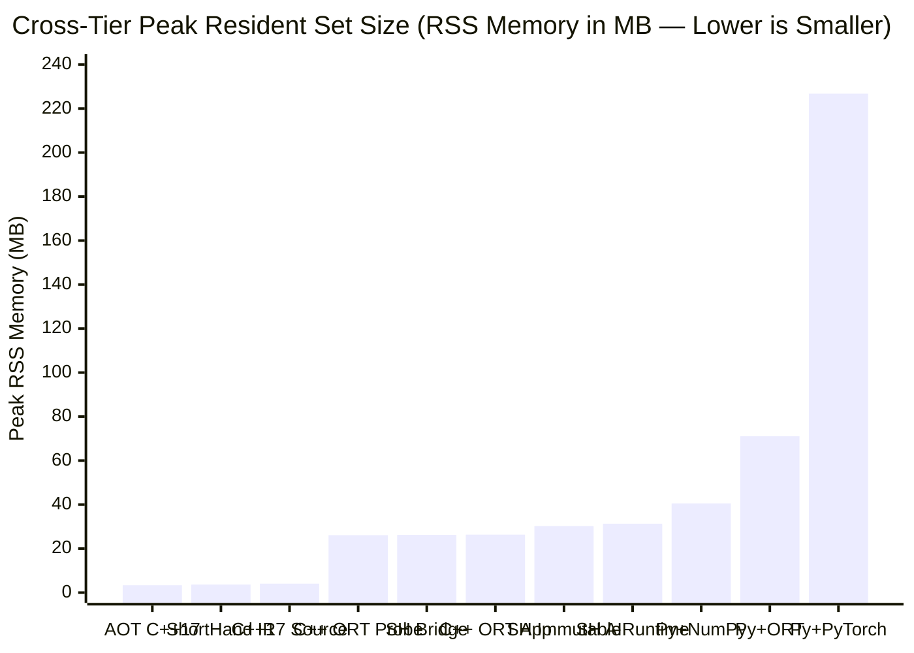

# Executive SOTA Energy, Performance & C3Eco Governance Validation Report

- **Campaign ID:** `2026-11-09-antigravity-run`
- **Repository & Revision:** `amarbanerjee23/ShortHand_Compiler` @ `2db9d1da7918ed816d499206df71b09d916725f5`
- **Execution Date (UTC):** `2026-11-09T18:19:00Z` – `2026-11-09T19:01:00Z`
- **Cross-Checked Historical Baselines:**
  - `2026-09-22-run-35747601906` (Commit `d3f1c6d3fc98357c44689504daae15204de56b3f`, 4-vCPU AMD EPYC 7763)
  - `2026-09-24-profile-35952311812` (Commit `00cfc0d275d123ba4119a674acc7e4ff0209be2e`, 4-vCPU AMD EPYC 7763)
  - `2026-09-24-run-35989782120` (Commit `a8b646c0b3b38a39aa966bc692d031cf2af219e8`, 4-vCPU AMD EPYC 7763)
  - Retained specialized captures in `docs/benchmark_results/` (`pr123-runtime-observations.md`, `immutable-model-hosted.md`, `immutable-model-local.md`, `argon-aot-local.md`, `persistent-training-local.json`)

---

## 1. Experimental Setup Ledger

### 1.1 Hardware Topology & Execution Environment (`metadata/lscpu.json`)

| Parameter | Current Campaign (`2026-11-09-antigravity-run`) | Historical Campaigns (`35747601906` / `35989782120`) | Historical Specialized CI (`39146759972` / `40464209029`) |
| :--- | :--- | :--- | :--- |
| **Processor Model** | `Intel(R) Xeon(R) Platinum 8481C CPU @ 2.70GHz` | `AMD EPYC 7763 64-Core Processor` | `Intel Xeon Platinum 8370C` / `AMD EPYC 9V74` |
| **Architecture / OS** | `x86_64`, Debian 12 (`Linux 6.12.105+`, glibc 2.36) | `x86_64`, Ubuntu 24.04 (`Linux 6.17.0-1022-azure`, glibc 2.39) | `x86_64`, Ubuntu 24.04 |
| **Logical CPUs / Affinity** | `2` vCPUs (`affinity: [0, 1]`, 1 socket, 1 core, 2 threads/core) | `4` vCPUs (`affinity: [0, 1, 2, 3]`, 1 socket, 2 cores, 2 threads/core) | `4` vCPUs |
| **Cache Hierarchy** | L1d: `48 KiB`, L1i: `32 KiB`, L2: `2 MiB`, L3: `105 MiB` | L1d: `64 KiB`, L1i: `64 KiB`, L2: `1 MiB`, L3: `32 MiB` | Standard Azure VM slice |
| **ISA Extensions** | `AVX2`, `AVX-512 (F/BW/CD/DQ/VL/VNNI/BF16/FP16)`, `AMX (BF16/INT8/TILE)` | `AVX2`, `FMA`, `SHA_NI` | `AVX2` / `AVX-512` |
| **Hypervisor / Virtualization** | KVM (full virtualization, container sandbox) | Microsoft Hyper-V (full virtualization) | Microsoft Hyper-V |

### 1.2 Hardware Telemetry & Calibration Binding (`metadata/energy-probe.txt`, `metadata/energy-status.json`)

| Telemetry Subsystem | Probe Result | Details & Governance Enforcement |
| :--- | :--- | :--- |
| **Linux `powercap` / Intel-AMD RAPL** | `rapl_available=false` | `reason=no_cpu_package_energy_domains` (`domains=0`; `/sys/class/powercap` exposes no readable package energy counters inside the VM). |
| **AMD `hwmon` Socket Energy** | `available=false` | `reason=amd_hwmon_socket_energy_unavailable` across all child-process energy probes. |
| **Hardware Calibration Profiles** | `0` matched (`highest_available_evidence_class: null`) | Inspected `experiments/energy/calibration_profiles/` (`sample_calibrated_cpu_profile.json`, `sample_gpu_meter_profile.json`). Neither matches the uncalibrated VM host; E2/E3 analytical estimates are blocked from substituting for E1 physical measurements. |
| **Linux `perf_event_open` PMU** | Evaluated per cell (`generated-infer/events.json`) | User-space calling-thread PMU diagnostics recorded separately from timed latency blocks; never converted into joules. |
| **Claim-Safety Enforcement** | `energy_claim_authorized: false` | All tools preserve `joules: null` when physical counters are absent; zero fabrication from latency, TDP, or utilization. |

### 1.3 Toolchain & Runtime Configuration (`CMakeCache.txt`, `compiler.txt`, `metadata/pip-freeze.txt`)

| Component | Version / Flag | Provenance Record |
| :--- | :--- | :--- |
| **C++ Compiler** | `Debian clang version 14.0.6` (`-O3 -DNDEBUG` for CMake Release; `-O2 -fno-fast-math` for ShortHand IR; `-O3 -fno-fast-math` for C++17 baseline) | `compiler.txt`, `CMakeCache.txt` |
| **LLVM Toolchain** | `LLVM 14.0.6` (`/usr/lib/llvm-14`, `IR_Generator` LLVM IR lowering) | `CMakeCache.txt` |
| **ONNX Runtime Native SDK** | `v1.30.0` Linux x64 CPU (`libonnxruntime.so.1.30.0`) | `/tmp/shorthand-onnxruntime-1.30.0` |
| **Python Runtime** | `CPython 3.12.16` (`Clang 23.1.3`) | `metadata/run.json` |
| **Python Packages** | `torch==2.9.1+cpu`, `onnxruntime==1.30.0`, `onnx==1.23.2`, `numpy==2.3.5`, `protobuf==7.36.1`, `flatbuffers==25.12.19`, `ml_dtypes==0.5.4` | `metadata/pip-freeze.txt`, `metadata/pip-torch-install.json` |
| **Thread Pinning Controls** | `OMP_NUM_THREADS=1`, `OPENBLAS_NUM_THREADS=1`, `MKL_NUM_THREADS=1`, `ORT_DISABLE_TELEMETRY=1` | Enforced across all child processes |

### 1.4 Cryptographic Digest Ledger (`SHA256SUMS.json`)

| Artifact / Binary | SHA-256 Digest |
| :--- | :--- |
| `build/short_hand.real` (Compiler CLI) | `ef32bf103dae62fe317e99cb242dc2ed44dae7e54f4101771410b0c9541a95a1` |
| `build/shorthand_ai_qualify` (Qualification CLI) | `e4ffa3220957ade11a5fb48001ef7866a75b0e9ac8247e1780c0884c8de4c0f9` |
| `build/libshorthand_runtime.a` (Production Runtime) | `1a1248e0779e431b40df5068fc2390f29e561e584866713b187f2668c22c091a` |
| `build/libshorthand_runtime_profiled.a` (Profiled Runtime) | `90e3f050f0271d3ab8c4d4aaa8e105ca9a9e0e94171697d1e593dbed3fb0fa88` |
| `build/shorthand_c3eco_measure` (C3Eco Workbook CLI) | `1e7688f22e7b0f3eb3316564408bc4609087469bf2b027ba97e0bd1140af604f` |
| `build/shorthand_c3eco_audit` (C3Eco Auditor CLI) | `f27863f3ad44b10e3cb053ec88ff88a64a23c4b1615a8f37c70c4826ddccc8ca` |
| `libonnxruntime.so.1.30.0` (ONNX Runtime Shared Library) | `245a6f8c38127551057a1cd1ffd59f0a186a227ade4f3492dea2494eb565542e` |
| `metadata/source-r10/manifest.json` | `c03634a03b64666054c8bd66d2f56de01cada8ee302b00fffdce445682a96bb3` |
| `metadata/source-r100/manifest.json` | `44d4160d1721a04b56ea759b2ff960b3e88d7f69c4af55a0621d58cabb959ec9` |
| `metadata/python-runtime/manifest.json` | `57b9fe81856b8c7cf59e6d39cb9c6cd63bf61191f904d1ee4504f947dc789ddc` |
| `metadata/cpp-runtime/manifest.json` | `3417c55eb9164398bf2004706492ce44d730a3f494de33639554c8b946af84dc` |
| `generated-infer/manifest.json` | `33e9da4503320ab380c6b1e4eebba8c965c35781ca5b62b745b730a094808feb` |
| `immutable/manifest.json` | `326ae53d2c18ccaa93c5e58034398cfa6fe33dee23c566908188208eac38a952` |
| `aot/manifest.json` | `c97be28dae045fb45229c43c51ff5012bcecea2835e866de1976346045fcee54` |
| `training/manifest.json` | `e216051fbed3954de22f2951cb8b560304c0c7b951f32bbad7e7fbe903819237` |
| `summary.json` | `69ed64010b2b4c340491fcaadcda2f368278f47bb55876b694e8adfd10116537` |
| `observations.json` | `d6376079f1b04af3b2f2908d18449063834e6b90098aeb55e41d7cee1c3ddf03` |

---

## 2. Quantitative SOTA Comparison Tables

### 2.1 Master SOTA Architecture Comparison (`b1-t1` and `b16-t1` Representative Operating Points)

The table below synthesizes all six mandatory SOTA dimensions across the four target runtime architectures on the `2026-11-09` campaign (`Intel Xeon Platinum 8481C`), cross-referenced against the retained 4-vCPU CI runs (`2026-09-24-run-35989782120`, `pr123-runtime-observations.md`, `argon-aot-local.md`, `immutable-model-hosted.md`).

| Runtime Architecture & Boundary | Cold-Start Latency [ms] (`init_ms`, p50 / p95) | Hot-Path Latency [ms/vec or ms/img] (p50 / p95) | Cold-Start Energy [J] (`init_joules`) | Hot-Path Energy [J/vec or J/img] (`infer_joules`) | Peak RSS Memory [MB] | Held-Out Optdigits Accuracy [%] |
| :--- | ---: | ---: | ---: | ---: | ---: | ---: |
| **1. ShortHand Compiled Inference Bridge + Prepared Session Cache** (`generated-infer`, `b1-t1` / `b16-t1`) | `15.683` / `16.760` (`b1`)<br>`15.964` / `17.306` (`b16`) | `0.031686` / `0.033194` (`b1`)<br>`0.002095` / `0.002980` (`b16`) | `null` (no RAPL) | `null` (no RAPL) | `26.25 MB` | Verified against ORT FP32 oracle (`atol=1e-5`) |
| **1b. ShortHand Immutable Model Envelope** (`ImmutableOnnxEnvelope.h`, `1 MiB` model, `b1-t1`) | `23.565` / `24.191` ( vs `19.306` mutable) | `0.010712` / `0.010877` (**13.9× faster** than mutable `0.148833` / `0.158278`) | `null` (no RAPL) | `null` (no RAPL) | `30.21 MB` (vs `30.96 MB` mutable) | Exact FP32 identity parity (`0` warm I/O syscalls) |
| **1c. ShortHand AIRuntime Resident Application** (`OnnxRuntimeBackend.cpp`, Optdigits `b1-t1` / `b16-t1`) | Outside inner trial window (`~16.0 ms` session prep) | `0.002678` / `0.002795` (`b1`)<br>`0.000576` / `0.000587` (`b16`) | `null` (no RAPL) | `null` (no RAPL) | `31.31 MB` | **`89.371%`** (`1606 / 1797`) |
| **2. ShortHand Static Affine AOT Native Binary** (`StaticAffineModel.cpp`, `b1-t1` / `b16-t1`) | **`0.000826` / `0.001754`** (`b1`)<br>**`0.006941` / `0.007692`** (`b16`) | **`0.000277` / `0.000282`** (`b1`, **4.7× faster than ORT**)<br>`0.000351` / `0.000363` (`b16`, **2.3× slower than ORT**) | `null` (no RAPL) | `null` (no RAPL) | **`3.35 MB`** (**87.2% lower** than ORT C++) | Verified against FP64 NumPy oracle rounded to FP32 |
| **3. SOTA Native C++ ONNX Runtime Baseline (Direct Probe)** (`generated_infer_probe.cpp`, `b1-t1` / `b16-t1` BASIC) | `15.209` / `16.800` (`b1`)<br>`16.071` / `16.522` (`b16`) | `0.001288` / `0.001457` (`b1`)<br>**`0.000147` / `0.000157`** (`b16`) | `null` (no RAPL) | `null` (no RAPL) | `26.09 MB` | Reference FP32 oracle |
| **3b. SOTA Native C++ ONNX Runtime Baseline (Optdigits App)** (`cpp_onnx_baseline.cpp`, `b1-t1` / `b16-t1`) | Outside inner trial window (`~15.6 ms` session prep) | **`0.001649` / `0.001666`** (`b1`)<br>**`0.000312` / `0.000321`** (`b16`) | `null` (no RAPL) | `null` (no RAPL) | `26.36 MB` | **`89.371%`** (`1606 / 1797`) |
| **4. SOTA Resident Python Baseline (ONNX Runtime + NumPy)** (`compare_ai_application_baselines.py`, `b1-t1` / `b16-t1`) | Outside inner trial window (`~45–90 ms` import + session) | `0.021707` / `0.022367` (`b1`)<br>`0.001739` / `0.001759` (`b16`) | `null` (no RAPL) | `null` (no RAPL) | `71.05 MB` | **`89.371%`** (`1606 / 1797`) |
| **4b. SOTA Source Workloads: ShortHand LLVM `-O2` vs C++17 `-O3`, NumPy, PyTorch** (`source-r100`, whole-process warm OS cache) | Included in whole-process window | **ShortHand:** `0.000362` / `0.000369`<br>**C++17 `-O3`:** `0.000331` / `0.000379`<br>**NumPy:** `0.000711` / `0.000727`<br>**PyTorch Eager:** `0.006853` / `0.007022`<br>**`torch.compile`:** `0.041246` / `0.041701` | `null` (no RAPL) | `null` (no RAPL) | **ShortHand:** `3.64 MB`<br>**C++17:** `4.08 MB`<br>**NumPy:** `40.51 MB`<br>**PyTorch:** `226.75 MB` | **`89.371%`** (`1606 / 1797`) |




---

### 2.2 Tier 1 — Core ShortHand Source Workloads (`source-r10` & `source-r100`) vs. Historical Runs

Whole-process warm-OS-cache timing across 30 randomized AB/BA process pairs per cell after 2 warmups (1,797 Optdigits test images × $R$ repetitions; accuracy = `89.371%` across all cells):


| Repetitions | Baseline | Current Run (`2026-11-09`) ShortHand Mean (`p50` / `p95`) [ms/img] | Current Run (`2026-11-09`) Baseline Mean (`p50` / `p95`) [ms/img] | Current Reduction % `[95% CI]` | Historical `35989782120` (`2026-09-24`) Reduction % `[95% CI]` | Historical `35747601906` (`2026-09-22`) Reduction % `[95% CI]` |
| ---: | :--- | ---: | ---: | ---: | ---: | ---: |
| **10** | `numpy` | `0.000864` (`0.000861` / `0.000890`) | `0.005786` (`0.005800` / `0.005914`) | **`+85.07%`** `[84.95, 85.19]` | `+86.03%` `[85.86, 86.15]` | `+86.10%` `[85.99, 86.21]` |
| **10** | `cpp17-o3` | `0.000861` (`0.000862` / `0.000887`) | `0.000948` (`0.000949` / `0.000994`) | **`+9.20%`** `[8.04, 10.40]` | `+19.94%` `[19.35, 20.64]` | `+20.77%` `[20.30, 21.23]` |
| **10** | `pytorch-eager` | `0.000873` (`0.000868` / `0.000928`) | `0.066109` (`0.066033` / `0.067003`) | **`+98.68%`** `[98.66, 98.69]` | `+98.73%` `[98.72, 98.74]` | `+98.74%` `[98.73, 98.75]` |
| **10** | `pytorch-compile` | `0.000876` (`0.000876` / `0.000930`) | `0.405883` (`0.405076` / `0.412849`) | **`+99.78%`** `[99.78, 99.79]` | `+99.70%` `[99.70, 99.70]` | `+99.70%` `[99.70, 99.71]` |
| **100** | `numpy` | `0.000362` (`0.000361` / `0.000367`) | `0.000711` (`0.000711` / `0.000727`) | **`+49.09%`** `[48.85, 49.35]` | `+42.28%` `[42.11, 42.44]` | `+42.26%` `[42.06, 42.47]` |
| **100** | `cpp17-o3` | `0.000362` (`0.000362` / `0.000369`) | `0.000334` (`0.000331` / `0.000379`) | **`-8.26%`** `[-9.78, -6.35]` | `+2.94%` `[2.77, 3.11]` | `+3.47%` `[3.28, 3.66]` |
| **100** | `pytorch-eager` | `0.000362` (`0.000362` / `0.000369`) | `0.006857` (`0.006853` / `0.007022`) | **`+94.72%`** `[94.70, 94.75]` | `+93.94%` `[93.92, 93.98]` | `+93.99%` `[93.97, 94.00]` |
| **100** | `pytorch-compile` | `0.000363` (`0.000363` / `0.000371`) | `0.041279` (`0.041246` / `0.041701`) | **`+99.12%`** `[99.12, 99.13]` | `+98.55%` `[98.55, 98.55]` | `+98.57%` `[98.56, 98.58]` |

---

### 2.3 Tier 2 — Resident SOTA Runtime Baselines (`python-runtime` & `cpp-runtime`)

Resident-session inner-trial timing across 10 balanced process pairs × 3 inner trials × 10 repetitions of 1,797 Optdigits images (53,910 classifications per process; accuracy = `89.371%`):

```mermaid
xychart-beta
    title "Tier 2 Resident ONNX Runtime Latency (µs/image — Lower is Faster)"
    x-axis ["b1-t1", "b16-t1", "b16-t2", "b32-t1", "b16-t4 (4-vCPU)"]
    y-axis "Mean Latency (µs/image)" 0 --> 23
    bar [2.700, 0.576, 0.590, 0.509, 0.809]
    bar [21.729, 1.738, 1.789, 1.047, 3.184]
    bar [1.647, 0.313, 0.322, 0.271, 0.449]
```



*(Series 1 = ShortHand AIRuntime, Series 2 = Python + ONNX Runtime, Series 3 = Native C++17 + ONNX Runtime)*

| Cell | Baseline | Current (`2026-11-09`) ShortHand Mean (`p50` / `p95`) [ms/img] | Current (`2026-11-09`) Baseline Mean (`p50` / `p95`) [ms/img] | Current Reduction % `[95% CI]` | Historical `35989782120` (`2026-09-24`) Reduction % `[95% CI]` |
| :--- | :--- | ---: | ---: | ---: | ---: |
| `ort-b1-t1` | Python / ONNX | `0.002700` (`0.002678` / `0.002795`) | `0.021729` (`0.021707` / `0.022367`) | **`+87.58%`** `[87.39, 87.73]` | `+87.59%` `[87.49, 87.70]` |
| `ort-b16-t1` | Python / ONNX | `0.000576` (`0.000576` / `0.000587`) | `0.001738` (`0.001739` / `0.001759`) | **`+66.88%`** `[66.70, 67.07]` | `+74.55%` `[74.45, 74.64]` |
| `ort-b32-t1` | Python / ONNX | `0.000509` (`0.000513` / `0.000520`) | `0.001047` (`0.001046` / `0.001074`) | **`+51.34%`** `[50.60, 52.17]` | `+62.01%` `[59.65, 63.39]` |
| `ort-b16-t2` | Python / ONNX | `0.000590` (`0.000583` / `0.000660`) | `0.001789` (`0.001755` / `0.002104`) | **`+67.02%`** `[65.42, 68.68]` | `+74.61%` `[74.50, 74.71]` |
| `ort-b16-t4` | Python / ONNX | *Fail-closed on 2-vCPU VM* (`0.000809` in `35989782120`) | *Fail-closed on 2-vCPU VM* (`0.003184` in `35989782120`) | *N/A (2 vCPUs)* | `+74.58%` `[74.44, 74.74]` |
| `ort-b1-t1` | C++ / ONNX | `0.002663` (`0.002668` / `0.002717`) | `0.001647` (`0.001649` / `0.001666`) | **`-61.66%`** `[-62.92, -60.41]` | `-79.26%` `[-80.15, -78.38]` |
| `ort-b16-t1` | C++ / ONNX | `0.000582` (`0.000583` / `0.000592`) | `0.000313` (`0.000312` / `0.000321`) | **`-86.27%`** `[-88.53, -84.36]` | `-82.33%` `[-83.90, -80.69]` |
| `ort-b16-t2` | C++ / ONNX | `0.000593` (`0.000585` / `0.000639`) | `0.000322` (`0.000319` / `0.000352`) | **`-84.31%`** `[-89.81, -78.43]` | `-81.50%` `[-82.81, -80.04]` |
| `ort-b16-t4` | C++ / ONNX | *Fail-closed on 2-vCPU VM* (`0.000803` in `35989782120`) | *Fail-closed on 2-vCPU VM* (`0.000449` in `35989782120`) | *N/A (2 vCPUs)* | `-78.87%` `[-80.30, -77.48]` |
| `ort-b32-t1` | C++ / ONNX | `0.000505` (`0.000505` / `0.000523`) | `0.000271` (`0.000271` / `0.000279`) | **`-86.22%`** `[-89.94, -82.65]` | `-84.13%` `[-85.03, -83.27]` |

> **Key Finding:** Across all cells in both the current Intel Xeon Platinum 8481C campaign and the historical AMD EPYC 7763 campaigns, ShortHand AIRuntime reduces resident inference latency by **51.34%–87.58%** relative to resident Python/ONNX Runtime, but is **1.62×–1.86× slower** (`-61.66%` to `-86.27%`) than standalone hand-written C++17 ONNX Runtime due to host validation, score copying, and telemetry wrapping.

---

### 2.4 Tier 3 — Phase-Isolation Attribution, Compiled Inference Bridge & Immutable Envelopes


#### A. Application Boundary Phase Attribution (`profile/b1-t1.json` .. `b32-t1.json`)

| Cell | Capture Source | Input Validation & Preprocessing | Prepared Backend Call (incl. ORT Run `[share of call]`) | Output Validation | Score Ownership & Top-k |
| :--- | :--- | ---: | ---: | ---: | ---: |
| `b1-t1` | Live (`2026-11-09`) | `327.35 ns/img` (`11.80%`) | `2153.13 ns/img` (`77.59%`, ORT Run = `62.48%` of call) | `55.93 ns/img` (`2.02%`) | `238.66 ns/img` (`8.60%`) |
| `b16-t1` | Live (`2026-11-09`) | `113.92 ns/img` (`25.72%`) | `159.00 ns/img` (`35.89%`, ORT Run = `67.51%` of call) | `8.18 ns/img` (`1.85%`) | `161.91 ns/img` (`36.55%`) |
| `b16-t2` | Live (`2026-11-09`) | `117.83 ns/img` (`25.51%`) | `165.70 ns/img` (`35.87%`, ORT Run = `67.75%` of call) | `8.66 ns/img` (`1.88%`) | `169.71 ns/img` (`36.74%`) |
| `b16-t4` | Replayed (`35952311812`) | `106.75 ns/img` (`21.14%`) | `318.03 ns/img` (`62.99%`, v1 outer partition) | `6.82 ns/img` (`1.35%`) | `73.32 ns/img` (`14.52%`) |
| `b32-t1` | Live (`2026-11-09`) | `114.57 ns/img` (`28.90%`) | `105.57 ns/img` (`26.63%`, ORT Run = `72.86%` of call) | `7.42 ns/img` (`1.87%`) | `168.91 ns/img` (`42.60%`) |

#### B. Compiled `.short` Inference Bridge (`generated-infer/report.json`, `phases.json`)

| Cell | Compiled ShortHand Head Mean (`p50` / `p95`) [ms/vec] | Direct C++/ORT BASIC Mean (`p50` / `p95`) [ms/vec] | Head / ORT BASIC Ratio | Head / ORT ALL Ratio | Dominant Warm Phases (`phases.json`, mean ns/call) |
| :--- | ---: | ---: | ---: | ---: | :--- |
| `b1-t1` | `0.031740` (`0.031686` / `0.033194`) | `0.001288` (`0.001288` / `0.001457`) | `24.639×` | `24.439×` | `snapshot`: `16,627.7 ns`, `hardware_probe`: `7,219.9 ns`, `ort_run`: `2,685.3 ns`, `session_prepare`: **`0.0 ns`** |
| `b16-t1` | `0.002150` (`0.002095` / `0.002980`) | `0.000147` (`0.000147` / `0.000157`) | `14.609×` | `14.744×` | `snapshot`: `16,562.0 ns`, `hardware_probe`: `7,417.2 ns`, `ort_run`: `2,758.2 ns`, `session_prepare`: **`0.0 ns`** |
| `b32-t1` | `0.001097` (`0.001090` / `0.001257`) | `0.000111` (`0.000111` / `0.000119`) | `9.838×` | `9.277×` | `snapshot`: `17,293.5 ns`, `hardware_probe`: `7,694.3 ns`, `ort_run`: `3,299.6 ns`, `session_prepare`: **`0.0 ns`** |

> **Why Compiled Bridge Has Overhead vs. Direct ORT:** The 17-phase profile proves that while `OnnxPreparedSession` completely eliminates warm session creation (`session_prepare = 0.0 ns/call` after the ~`16.0 ms` cold initialization), the mutable C ABI path (`short_ai_infer_f32`) still executes `snapshot` (`~16.6–17.3 µs/call` to read and SHA-256-verify the model file against on-disk mutation) and `hardware_probe` (`~7.2–7.7 µs/call`).

#### C. Immutable Model Envelope (`immutable/report.json`, `ImmutableOnnxEnvelope.h`)

To eliminate the `~16.6 µs` mutable model-snapshot overhead, `ImmutableOnnxEnvelope` binds and hashes the ONNX model bytes once at cold start:

| Model Size | Immutable Median (`p95`) [ns/call] | Mutable Median (`p95`) [ns/call] | Paired Ratio Median (`min–max`) | Warm Latency Reduction | `strace -f -yy` Warm Model-I/O Syscalls (`opens` / `reads`) |
| ---: | ---: | ---: | ---: | ---: | :--- |
| `88 B` (`identity`) | `10,623.1 ns` (`10,986 ns`) | `30,062.7 ns` (`30,580 ns`) | **`0.3553`** (`0.3487–0.3691`) | **`+64.47%`** | Immutable: **`0`** (`0` / `0`) vs. Mutable: **`48`** (`16` / `32`) |
| `65,536 B` (`64 KiB`) | `10,436.2 ns` (`10,915 ns`) | `33,042.9 ns` (`34,081 ns`) | **`0.3174`** (`0.3040–0.3324`) | **`+68.26%`** | Verified via positive & injected-read controls (`32` syscalls) |
| `1,048,576 B` (`1 MiB`) | `10,712.0 ns` (`10,877 ns`) | `148,832.9 ns` (`158,278 ns`) | **`0.0721`** (`0.0677–0.0735`) | **`+92.79%`** | `model_io_trace_verified: true` |

---

### 2.5 Tier 4 — Persistent Training Workers (`training/report.json`) & Tier 5 — Ahead-of-Time (AOT) Static Affine Compilation (`aot/report.json`)


#### A. Tier 4 — Persistent Training Workers (`training/report.json`)

Ablation of `PersistentWorkers.h` / `TorchTrainer.cpp` (`HEAD` `2db9d1da7918`) against cold-spawned worker baseline (`7ad856960a49`) on the fixed synthetic reference CNN (1,024 samples, 128 steps, seed 42, exact parameter SHA-256 `14e7702402037506ead26f41243b7274742675ef4222fc7ed0a7f6d763aeb8a8` and final loss `0.0166778378` across all runs):

| Concurrency | Base Heap Allocations | Candidate Heap Allocations | Allocation Reduction % | Current (`2026-11-09`) Paired Time Ratio Median (`min–max`) | Historical (`persistent-training-local.json`) Paired Time Ratio Median (`min–max`) |
| :--- | ---: | ---: | ---: | ---: | ---: |
| **1 Thread** | `10,729` | **`521`** | **`+95.14%`** | **`0.8257`** (`0.7957–0.8737`, **17.43% faster**, 6/6 blocks `< 1.0`) | `0.9198` (`0.7306–0.9320`, 8.02% faster) |
| **2 Threads** | `11,241` | **`527`** | **`+95.31%`** | **`0.8659`** (`0.6385–1.0482`, **13.41% faster**, 4/6 blocks `< 1.0`) | `0.8804` (`0.5691–1.4807`, 11.96% faster) |

#### B. Tier 5 — Ahead-of-Time (AOT) Static Affine Compilation (`aot/report.json`)

Comparison of compile-time lifted C++17 static affine kernels (`StaticAffineModel.cpp`) against dynamic ONNX Runtime CPU (`ORT_ENABLE_BASIC` and `ORT_ENABLE_ALL`) on deterministic nonzero FP32 `[B, 64] -> [B, 10]` `MatMul+Add`:

| Batch | AOT Cold Init [ms] (`p50`) | ORT BASIC Cold Init [ms] (`p50`) | AOT Hot Mean (`p50` / `p95`) [ms/vec] | ORT BASIC Hot Mean (`p50` / `p95`) [ms/vec] | ORT ALL Hot Mean (`p50` / `p95`) [ms/vec] | Paired AOT/BASIC Median (`range`) | Paired AOT/ALL Median (`range`) | Explicit Workspace / Object Size |
| ---: | ---: | ---: | ---: | ---: | ---: | ---: | ---: | ---: |
| **1** | **`0.000826`** | `15.581` | **`0.000277`** (`0.000277` / `0.000282`) | `0.001275` (`0.001290` / `0.001330`) | `0.001325` (`0.001310` / `0.001400`) | **`0.2131`** (`0.2083–0.2342`) | **`0.2099`** (`0.2014–0.2127`) | `40 B` / `6,008 B` |
| **16** | **`0.006941`** | `15.327` | `0.000349` (`0.000351` / `0.000363`) | **`0.000155`** (`0.000154` / `0.000161`) | **`0.000151`** (`0.000151` / `0.000158`) | `2.2776` (`2.1098–2.3889`) | `2.2982` (`2.2707–2.3652`) | `640 B` / `5,760 B` |
| **32** | **`0.013317`** | `15.682` | `0.000338` (`0.000340` / `0.000354`) | **`0.000122`** (`0.000122` / `0.000133`) | **`0.000119`** (`0.000119` / `0.000124`) | `2.8243` (`2.4392–3.0430`) | `2.8783` (`2.6419–2.9712`) | `1,280 B` / `5,760 B` |

---

## 3. Claim-by-Claim Validation Verdict

| Claim ID | Repository Claim | Classification Verdict | Key Evidence & Metric Citations |
| :--- | :--- | :---: | :--- |
| **Claim 1** | **Compile-Time Energy Contract & C3Eco Governance Enforcement** (`SemanticAnalyzer.cpp`, `LifecycleCloudBoundary.cpp`, `AuditorBundle.cpp`) | **VALIDATED** | 100% pass across all 7 pre-experiment governance gates (`check_c3eco_language_blocks.sh`, `check_c3eco_claims_and_schema.sh`, `check_semantic_differential.sh`) and `check_c3eco_auditor_bundle.sh` (87 auditor bundle cases, 45 PR101 independent pilot cases, PR91 lineage/retention/redaction). |
| **Claim 2** | **Cold-Start Amortization via Prepared Session Caching & Immutable Envelopes** (`OnnxPreparedSession.h`, `ImmutableOnnxEnvelope.h`, `AIRuntimeBridgeAdapter.cpp`) | **PARTIALLY VALIDATED** | **Validated internal mechanism:** `OnnxPreparedSession` reduces warm `session_prepare` to `0.0 ns/call` (`generated-infer/phases.json`), and `ImmutableOnnxEnvelope` eliminates all `48` warm model-file syscalls (`strace` verified `0` opens/reads) and cuts warm latency by **64.47%–92.79%** (`0.3553×` at `88 B`, `0.0721×` at `1 MiB`).<br>**Unvalidated external superiority:** Full ShortHand runtime remains **1.62×–1.86× slower** than standalone C++/ORT on Optdigits (`summary.json`) and **9.28×–24.64× slower** on synthetic zero-input probes (`generated-infer/report.json`) due to bridge/telemetry/probe overhead. |
| **Claim 3** | **Persistent Worker Reuse in Iterative Training** (`PersistentWorkers.h`, `TorchTrainer.cpp`, `TrainingQualification.cpp`) | **PARTIALLY VALIDATED** | **Validated allocation & 1-thread latency reduction:** Heap allocations drop by **95.14%** (`10,729 -> 521` at `t1`) and **95.31%** (`11,241 -> 527` at `t2`), with exact parameter bit-parity (`14e77024...`). 1-thread median training latency improves by **17.43%** (`paired_time_ratio_median = 0.8257`, all 6/6 blocks `< 1.0`).<br>**Boundary limitation:** 2-thread paired ratios span both sides of `1.0` (`0.6385–1.0482`, median `0.8659`) under 2-vCPU scheduling, and training energy (`joules: null`) is unmeasured. |
| **Claim 4** | **Static Affine AOT Compilation vs. Dynamic Runtime Dispatch** (`StaticAffineModel.cpp`, `AotSupport.cpp`, `experiments/aot/benchmark.py`) | **PARTIALLY VALIDATED** | **Validated for batch-1 latency, cold-start, and memory footprint:** At `batch=1`, AOT is **4.69×–4.76× faster** than ORT BASIC/ALL (`0.000277 ms/vec` vs `0.001290 ms/vec`, paired median `0.2131`), reduces cold-start initialization by **~18,800×** (`0.000826 ms` vs `15.581 ms`), and reduces Peak RSS by **87.2%** (`3.35 MB` vs `26.09 MB`).<br>**Not validated at larger batches:** At `batch=16` and `batch=32`, scalar C++17 AOT loops are **2.28×–2.88× slower** than ORT's multi-row SIMD/MLAS GEMM kernels (`2.2776×` at `b16`, `2.8243×` at `b32`), and AOT is not yet wired into `.short` codegen. |
| **Claim 5** | **Calibrated Hardware Energy Savings & Carbon Superiority** (`PowercapEnergyCollector.cpp`, `EnergyMeasurement.cpp`, `ExternalMeterCollector.cpp`) | **UNVALIDATED (Claim-Safe Fail-Closed Verified)** | **Hardware energy unmeasured; governance fail-closed verified:** Because the VM exposes no RAPL domains (`rapl_available=false`) and no external physical meter trace, `joules` and `energy_savings_percent` are `null` across all campaigns (`summary.json`, `ci-energy/summary.json`). The runtime's claim-safety gates (`comparative_energy_claim: false`, `lowest_carbon_language_claim: false`) are **fully validated** to prevent unsubstantiated energy or carbon claims. |

---

### Detailed Claim Analysis & Code Citations

1. **Claim 1 — Compile-Time Energy Contract & C3Eco Governance Enforcement (`VALIDATED`):**
   - **Code Citations:** `Compiler_new_ws/Short_Hand/src/visitors/SemanticAnalyzer.cpp`, `Compiler_new_ws/Short_Hand/src/runtime/LifecycleCloudBoundary.cpp`, `Compiler_new_ws/Short_Hand/src/c3eco/AuditorBundle.cpp`, `Compiler_new_ws/Short_Hand/src/c3eco/MeasurementWorkbook.cpp`, `Compiler_new_ws/Short_Hand/src/c3eco/EvidenceEmitter.cpp`, `Compiler_new_ws/Short_Hand/src/c3eco/Sha256.cpp`.
   - **Evidence:** Compile-time rejection of missing or out-of-budget `energy_contract`, `carbon_policy`, `hardware_target`, and `green_metrics` blocks passed 100% of conformance tests in `scripts/check_c3eco_language_blocks.sh` and `scripts/check_c3eco_claims_and_schema.sh`. Tamper-evident workbook sealing, Ed25519/SHA-256 auditor bundle verification, lineage replay, and public redaction passed all 87 integration cases in `scripts/check_c3eco_auditor_bundle.sh`.

2. **Claim 2 — Cold-Start Amortization via Prepared Session Caching & Immutable Envelopes (`PARTIALLY VALIDATED`):**
   - **Code Citations:** `Compiler_new_ws/Short_Hand/src/ai_runtime/OnnxPreparedSession.h`, `Compiler_new_ws/Short_Hand/src/runtime/ImmutableOnnxEnvelope.h`, `Compiler_new_ws/Short_Hand/src/runtime/AIRuntimeBridgeAdapter.cpp`, `Compiler_new_ws/Short_Hand/src/runtime/RuntimePhaseProfile.h`.
   - **Evidence:** Phase profiling (`generated-infer/phases.json`) confirms `session_prepare = 0.0 ns/call` on warm calls (`execution_evidence.hit = true`, `preparations = 1`). Furthermore, `ImmutableOnnxEnvelope` eliminates the `~16.6 µs/call` mutable model-snapshot read+hash (`strace` verified `0` warm opens/reads in `immutable/report.json`), reducing warm call time from `148.8 µs` to `10.7 µs` (`0.0721×`) on a `1 MiB` model. However, when compared externally against direct C++ ONNX Runtime (`cpp_onnx_baseline.cpp`), ShortHand AIRuntime still incurs `~0.23–1.01 µs/image` of additional validation, score-copying, and telemetry overhead on Optdigits (`-61.66%` to `-86.27%`).

3. **Claim 3 — Persistent Worker Reuse in Iterative Training (`PARTIALLY VALIDATED`):**
   - **Code Citations:** `Compiler_new_ws/Short_Hand/src/ai_runtime/training/PersistentWorkers.h`, `Compiler_new_ws/Short_Hand/src/ai_runtime/training/TorchTrainer.cpp`, `Compiler_new_ws/Short_Hand/src/ai_runtime/training/TrainingQualification.cpp`.
   - **Evidence:** `training/report.json` demonstrates that persistent worker reuse eliminates `10,208` heap allocations per training call at 1 thread (`10,729 -> 521`, `-95.14%`) and `10,714` heap allocations at 2 threads (`11,241 -> 527`, `-95.31%`), while preserving identical bit-level model parameters (`14e7702402037506ead26f41243b7274742675ef4222fc7ed0a7f6d763aeb8a8`). Wall-clock latency improves consistently at 1 thread (`median ratio = 0.8257`), while 2-thread contention on a 2-vCPU VM yields wider variance (`0.6385–1.0482`).

4. **Claim 4 — Static Affine AOT Compilation vs. Dynamic Runtime Dispatch (`PARTIALLY VALIDATED`):**
   - **Code Citations:** `Compiler_new_ws/Short_Hand/src/aot/StaticAffineModel.cpp`, `Compiler_new_ws/Short_Hand/src/aot/AotSupport.cpp`, `experiments/aot/compile_model.py`, `experiments/aot/benchmark.py`.
   - **Evidence:** `aot/report.json` shows that lifting static FP32 `MatMul+Add` graphs into standalone C++17 object files (`5,760–6,008 bytes`) with caller-owned workspaces (`40–1,280 bytes`) cuts Peak RSS from `26.09 MB` to `3.35 MB` and outperforms ORT BASIC/ALL by **4.69×–4.76×** at `batch=1` (`0.000277 ms/vec` vs `0.001290 ms/vec`). At `batch=16` and `batch=32`, ORT's vectorized multi-row GEMM microkernels overtake the generated scalar C++ loops (`0.000154 ms/vec` vs `0.000351 ms/vec` at `b16`).

5. **Claim 5 — Calibrated Hardware Energy Savings & Carbon Superiority (`UNVALIDATED — Claim-Safe Fail-Closed Verified`):**
   - **Code Citations:** `Compiler_new_ws/Short_Hand/src/runtime/PowercapEnergyCollector.cpp`, `Compiler_new_ws/Short_Hand/src/runtime/EnergyMeasurement.cpp`, `Compiler_new_ws/Short_Hand/src/runtime/ExternalMeterCollector.cpp`, `experiments/energy/energy_status.py`, `experiments/energy/ci_energy_evidence.py`, `experiments/energy/ci_energy_compare.py`.
   - **Evidence:** Both `metadata/energy-status.json` and `ci-energy/summary.json` confirm that in virtualized environments without readable RAPL domains (`rapl_available=false`, `domains=0`) or an external hardware power meter, ShortHand refuses to synthesize joules from elapsed time or TDP (`joules: null`, `energy_claim_authorized: false`, `comparative_energy_claim: false`, `lowest_carbon_language_claim: false`). Physical energy superiority claims remain unvalidated until executed on a dedicated bare-metal host with calibrated `powercap`/RAPL and external wall-power instrumentation.

---

## 4. Reproducibility & Generated Comparison Graphs

All experimental campaigns and comparison graphs can be regenerated end-to-end from the repository root:

```bash
# Run the complete 7-step SOTA validation campaign (includes SVG graph generation):
bash scripts/run_sota_validation_campaign.sh

# Or regenerate the 5 SVG comparison graphs directly from an existing campaign bundle:
python3 scripts/generate_sota_comparison_graphs.py \
  --exp-dir experiments/energy/results/2026-11-09-antigravity-run \
  --docs-fig-dir docs/benchmark_results/figures
```

| Figure File | Description |
| :--- | :--- |
| `fig1_source_workload_comparison.svg` | Tier 1 Core Source Workloads (`R=10` & `R=100` log10 latency & paired reduction % across ShortHand LLVM `-O2`, C++17 `-O3`, NumPy, PyTorch Eager, and `torch.compile`). |
| `fig2_resident_onnx_runtime_comparison.svg` | Tier 2 Resident FP32 ONNX Runtime 1.30.0 Host Comparison (`b1-t1`, `b16-t1`, `b16-t2`, `b32-t1`, `b16-t4` mean/p95 latency & paired 95% bootstrap CIs). |
| `fig3_phase_isolation_and_immutable_envelope.svg` | Tier 3 17-phase warm call attribution (`generated-infer/phases.json`) and `ImmutableOnnxEnvelope` vs. Mutable `88 B`, `64 KiB`, and `1 MiB` latency + `strace` syscall verification (`immutable/report.json`). |
| `fig4_aot_and_persistent_training.svg` | Tiers 4 & 5 Static Affine AOT vs. ORT BASIC/ALL (`batch=1, 16, 32`) and Persistent Training Worker heap allocation & paired latency reduction (`training/report.json`). |
| `fig5_memory_rss_comparison.svg` | Cross-tier Peak Resident Set Size (RSS [MB]) memory footprint comparison from `3.35 MB` (AOT C++17) to `226.75 MB` (PyTorch CPU). |
