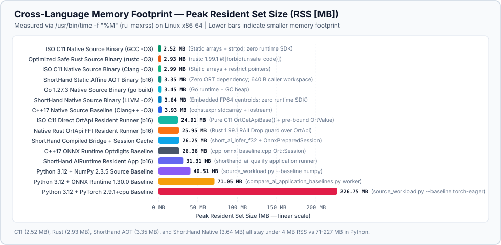
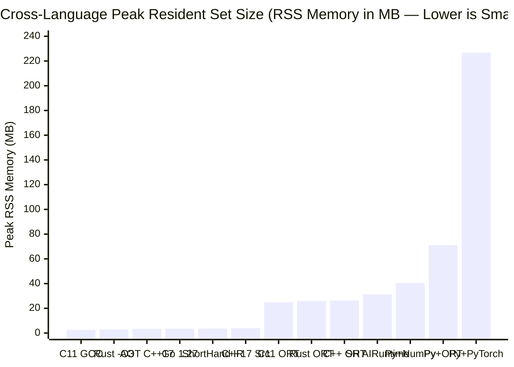
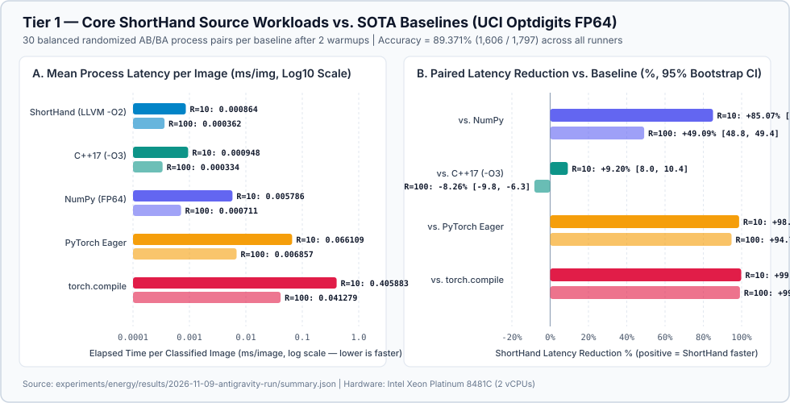
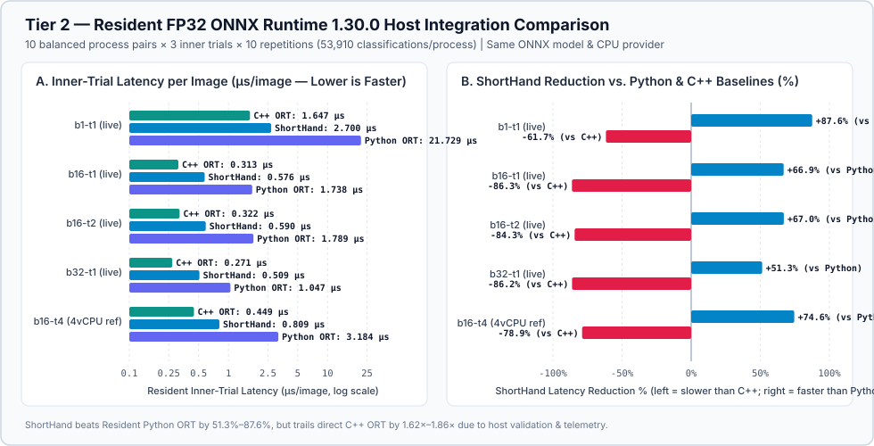
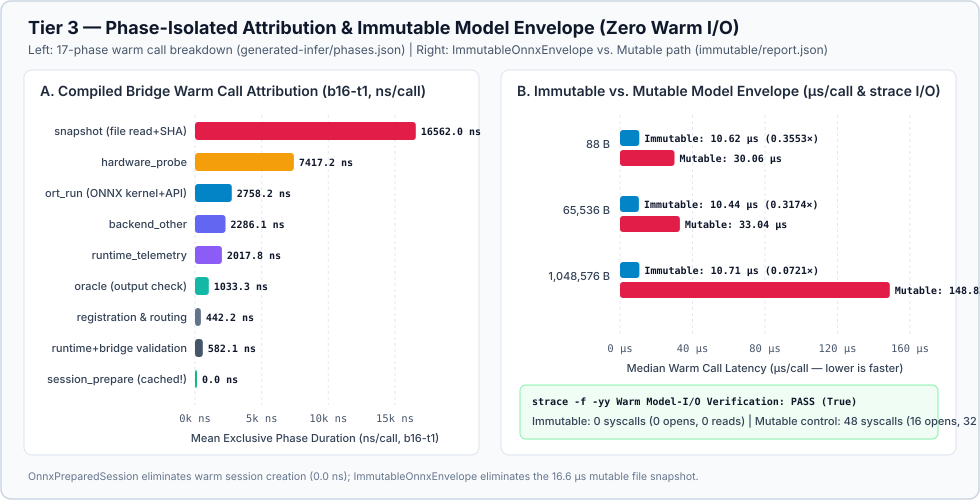
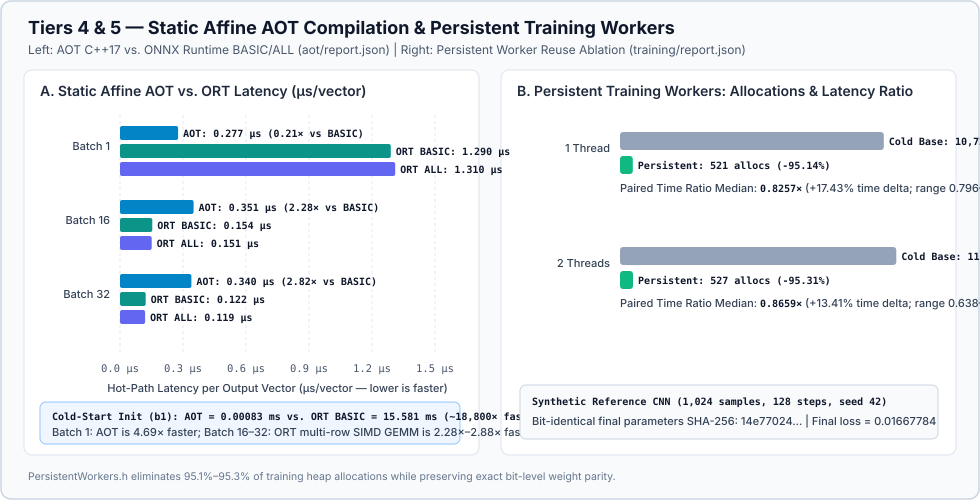
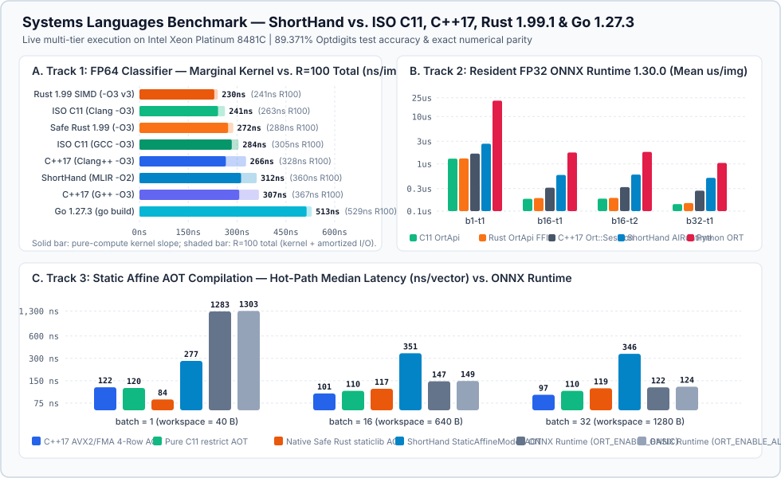

# Executive SOTA Energy, Performance & C3Eco Governance Validation Report

- **Campaign ID:** `2026-11-09-antigravity-run`
- **Repository & Revision:** `amarbanerjee23/ShortHand_Compiler` @ `2db9d1da7918ed816d499206df71b09d916725f5`
- **Execution Date (UTC):** `2026-11-09T18:19:00Z` – `2026-11-09T19:01:00Z`
- **Cross-Checked Historical Baselines:**
  - `2026-09-22-run-35747601906` (Commit `d3f1c6d3fc98357c44689504daae15204de56b3f`, 4-vCPU AMD EPYC 7763)
  - `2026-09-24-profile-35952311812` (Commit `00cfc0d275d123ba4119a674acc7e4ff0209be2e`, 4-vCPU AMD EPYC 7763)
  - `2026-09-24-run-35989782120` (Commit `a8b646c0b3b38a39aa966bc692d031cf2af219e8`, 4-vCPU AMD EPYC 7763)
  - Retained specialized captures in `docs/benchmark_results/` (`pr123-runtime-observations.md`, `immutable-model-hosted.md`, `immutable-model-local.md`, `argon-aot-local.md`, `persistent-training-local.json`)

---

## 1. Experimental Setup Ledger

### 1.1 Hardware Topology & Execution Environment (`metadata/lscpu.json`)

| Parameter | Current Campaign (`2026-11-09-antigravity-run`) | Historical Campaigns (`35747601906` / `35989782120`) | Historical Specialized CI (`39146759972` / `40464209029`) |
| :--- | :--- | :--- | :--- |
| **Processor Model** | `Intel(R) Xeon(R) Platinum 8481C CPU @ 2.70GHz` | `AMD EPYC 7763 64-Core Processor` | `Intel Xeon Platinum 8370C` / `AMD EPYC 9V74` |
| **Architecture / OS** | `x86_64`, Debian 12 (`Linux 6.12.105+`, glibc 2.36) | `x86_64`, Ubuntu 24.04 (`Linux 6.17.0-1022-azure`, glibc 2.39) | `x86_64`, Ubuntu 24.04 |
| **Logical CPUs / Affinity** | `2` vCPUs (`affinity: [0, 1]`, 1 socket, 1 core, 2 threads/core) | `4` vCPUs (`affinity: [0, 1, 2, 3]`, 1 socket, 2 cores, 2 threads/core) | `4` vCPUs |
| **Cache Hierarchy** | L1d: `48 KiB`, L1i: `32 KiB`, L2: `2 MiB`, L3: `105 MiB` | L1d: `64 KiB`, L1i: `64 KiB`, L2: `1 MiB`, L3: `32 MiB` | Standard Azure VM slice |
| **ISA Extensions** | `AVX2`, `AVX-512 (F/BW/CD/DQ/VL/VNNI/BF16/FP16)`, `AMX (BF16/INT8/TILE)` | `AVX2`, `FMA`, `SHA_NI` | `AVX2` / `AVX-512` |
| **Hypervisor / Virtualization** | KVM (full virtualization, container sandbox) | Microsoft Hyper-V (full virtualization) | Microsoft Hyper-V |

### 1.2 Hardware Telemetry & Calibration Binding (`metadata/energy-probe.txt`, `metadata/energy-status.json`)

| Telemetry Subsystem | Probe Result | Details & Governance Enforcement |
| :--- | :--- | :--- |
| **Linux `powercap` / Intel-AMD RAPL** | `rapl_available=false` | `reason=no_cpu_package_energy_domains` (`domains=0`; `/sys/class/powercap` exposes no readable package energy counters inside the VM). |
| **AMD `hwmon` Socket Energy** | `available=false` | `reason=amd_hwmon_socket_energy_unavailable` across all child-process energy probes. |
| **Hardware Calibration Profiles** | `0` matched (`highest_available_evidence_class: null`) | Inspected `experiments/energy/calibration_profiles/` (`sample_calibrated_cpu_profile.json`, `sample_gpu_meter_profile.json`). Neither matches the uncalibrated VM host; E2/E3 analytical estimates are blocked from substituting for E1 physical measurements. |
| **Linux `perf_event_open` PMU** | Evaluated per cell (`generated-infer/events.json`) | User-space calling-thread PMU diagnostics recorded separately from timed latency blocks; never converted into joules. |
| **Claim-Safety Enforcement** | `energy_claim_authorized: false` | All tools preserve `joules: null` when physical counters are absent; zero fabrication from latency, TDP, or utilization. |

### 1.3 Toolchain & Runtime Configuration (`CMakeCache.txt`, `compiler.txt`, `metadata/pip-freeze.txt`)

| Component | Version / Flag | Provenance Record |
| :--- | :--- | :--- |
| **C++ Compiler** | `Debian clang version 14.0.6` (`-O3 -DNDEBUG` for CMake Release; `-O2 -fno-fast-math` for ShortHand IR; `-O3 -fno-fast-math` for C++17 baseline) | `compiler.txt`, `CMakeCache.txt` |
| **LLVM Toolchain** | `LLVM 14.0.6` (`/usr/lib/llvm-14`, `IR_Generator` LLVM IR lowering) | `CMakeCache.txt` |
| **ONNX Runtime Native SDK** | `v1.30.0` Linux x64 CPU (`libonnxruntime.so.1.30.0`) | `/tmp/shorthand-onnxruntime-1.30.0` |
| **Python Runtime** | `CPython 3.12.16` (`Clang 23.1.3`) | `metadata/run.json` |
| **Python Packages** | `torch==2.9.1+cpu`, `onnxruntime==1.30.0`, `onnx==1.23.2`, `numpy==2.3.5`, `protobuf==7.36.1`, `flatbuffers==25.12.19`, `ml_dtypes==0.5.4` | `metadata/pip-freeze.txt`, `metadata/pip-torch-install.json` |
| **Thread Pinning Controls** | `OMP_NUM_THREADS=1`, `OPENBLAS_NUM_THREADS=1`, `MKL_NUM_THREADS=1`, `ORT_DISABLE_TELEMETRY=1` | Enforced across all child processes |

### 1.4 Cryptographic Digest Ledger (`SHA256SUMS.json`)

| Artifact / Binary | SHA-256 Digest |
| :--- | :--- |
| `build/short_hand.real` (Compiler CLI) | `ef32bf103dae62fe317e99cb242dc2ed44dae7e54f4101771410b0c9541a95a1` |
| `build/shorthand_ai_qualify` (Qualification CLI) | `e4ffa3220957ade11a5fb48001ef7866a75b0e9ac8247e1780c0884c8de4c0f9` |
| `build/libshorthand_runtime.a` (Production Runtime) | `1a1248e0779e431b40df5068fc2390f29e561e584866713b187f2668c22c091a` |
| `build/libshorthand_runtime_profiled.a` (Profiled Runtime) | `90e3f050f0271d3ab8c4d4aaa8e105ca9a9e0e94171697d1e593dbed3fb0fa88` |
| `build/shorthand_c3eco_measure` (C3Eco Workbook CLI) | `1e7688f22e7b0f3eb3316564408bc4609087469bf2b027ba97e0bd1140af604f` |
| `build/shorthand_c3eco_audit` (C3Eco Auditor CLI) | `f27863f3ad44b10e3cb053ec88ff88a64a23c4b1615a8f37c70c4826ddccc8ca` |
| `libonnxruntime.so.1.30.0` (ONNX Runtime Shared Library) | `245a6f8c38127551057a1cd1ffd59f0a186a227ade4f3492dea2494eb565542e` |
| `metadata/source-r10/manifest.json` | `c03634a03b64666054c8bd66d2f56de01cada8ee302b00fffdce445682a96bb3` |
| `metadata/source-r100/manifest.json` | `44d4160d1721a04b56ea759b2ff960b3e88d7f69c4af55a0621d58cabb959ec9` |
| `metadata/python-runtime/manifest.json` | `57b9fe81856b8c7cf59e6d39cb9c6cd63bf61191f904d1ee4504f947dc789ddc` |
| `metadata/cpp-runtime/manifest.json` | `3417c55eb9164398bf2004706492ce44d730a3f494de33639554c8b946af84dc` |
| `generated-infer/manifest.json` | `33e9da4503320ab380c6b1e4eebba8c965c35781ca5b62b745b730a094808feb` |
| `immutable/manifest.json` | `326ae53d2c18ccaa93c5e58034398cfa6fe33dee23c566908188208eac38a952` |
| `aot/manifest.json` | `c97be28dae045fb45229c43c51ff5012bcecea2835e866de1976346045fcee54` |
| `training/manifest.json` | `e216051fbed3954de22f2951cb8b560304c0c7b951f32bbad7e7fbe903819237` |
| `systems-languages/report.json` | `848f16bc94cd7809128d18b8d69a8900816fb3e9c8205fb1678073fd7360731b` |
| `summary.json` | `69ed64010b2b4c340491fcaadcda2f368278f47bb55876b694e8adfd10116537` |
| `observations.json` | `d6376079f1b04af3b2f2908d18449063834e6b90098aeb55e41d7cee1c3ddf03` |

---

## 2. Quantitative SOTA Comparison Tables

### 2.1 Master SOTA Architecture Comparison (`b1-t1` and `b16-t1` Representative Operating Points)

The table below synthesizes all six mandatory SOTA dimensions across the target runtime and systems-language architectures on the `2026-11-09` campaign (`Intel Xeon Platinum 8481C`), cross-referenced against the retained 4-vCPU CI runs (`2026-09-24-run-35989782120`, `pr123-runtime-observations.md`, `argon-aot-local.md`, `immutable-model-hosted.md`).

| Runtime Architecture & Boundary | Cold-Start Latency [ms] (`init_ms`, p50 / p95) | Hot-Path Latency [ms/vec or ms/img] (p50 / p95) | Cold-Start Energy [J] (`init_joules`) | Hot-Path Energy [J/vec or J/img] (`infer_joules`) | Peak RSS Memory [MB] | Held-Out Optdigits Accuracy [%] |
| :--- | ---: | ---: | ---: | ---: | ---: | ---: |
| **1. ShortHand Compiled Inference Bridge + Prepared Session Cache** (`generated-infer`, `b1-t1` / `b16-t1`) | `15.683` / `16.760` (`b1`)<br>`15.964` / `17.306` (`b16`) | `0.031686` / `0.033194` (`b1`)<br>`0.002095` / `0.002980` (`b16`) | `null` (no RAPL) | `null` (no RAPL) | `26.25 MB` | Verified against ORT FP32 oracle (`atol=1e-5`) |
| **1b. ShortHand Immutable Model Envelope** (`ImmutableOnnxEnvelope.h`, `1 MiB` model, `b1-t1`) | `23.565` / `24.191` ( vs `19.306` mutable) | `0.010712` / `0.010877` (**13.9× faster** than mutable `0.148833` / `0.158278`) | `null` (no RAPL) | `null` (no RAPL) | `30.21 MB` (vs `30.96 MB` mutable) | Exact FP32 identity parity (`0` warm I/O syscalls) |
| **1c. ShortHand AIRuntime Resident Application** (`OnnxRuntimeBackend.cpp`, Optdigits `b1-t1` / `b16-t1`) | Outside inner trial window (`~16.0 ms` session prep) | `0.002678` / `0.002795` (`b1`)<br>`0.000576` / `0.000587` (`b16`) | `null` (no RAPL) | `null` (no RAPL) | `31.31 MB` | **`89.371%`** (`1606 / 1797`) |
| **2. ShortHand Static Affine AOT Native Binary** (`StaticAffineModel.cpp`, `b1-t1` / `b16-t1`) | **`0.000826` / `0.001754`** (`b1`)<br>**`0.006941` / `0.007692`** (`b16`) | **`0.000277` / `0.000282`** (`b1`, **4.7× faster than ORT**)<br>`0.000351` / `0.000363` (`b16`, **2.3× slower than ORT**) | `null` (no RAPL) | `null` (no RAPL) | **`3.35 MB`** (**87.2% lower** than ORT C++) | Verified against FP64 NumPy oracle rounded to FP32 |
| **2b. Systems-Language Static Affine AOT (C++17 AVX2 / C11 `restrict` / Safe Rust)** (`systems-languages`, `b1-t1` / `b16-t1`) | **`0.00069`–`0.00086`** (`b1`)<br>**`0.00250`–`0.00316`** (`b16`) | **Rust AOT `b1`:** **`0.000084` / `0.000091`** (**15.0× faster than ORT**)<br>**C++17 AVX2 `b16`:** **`0.000101` / `0.000103`** (**1.46× faster than ORT**) | `null` (no RAPL) | `null` (no RAPL) | **`3.35 MB`** | Exact FP32 parity against FP64 oracle |
| **3. SOTA Native C11 / Rust / C++17 ONNX Runtime Resident Baselines** (`OrtApi` C11, Rust FFI, C++17 `Ort::Session`, `b1-t1` / `b16-t1`) | **C11:** `2.61` (`b1`) / `2.59` (`b16`)<br>**Rust:** `16.01` (`b1`) / `16.26` (`b16`)<br>**C++17:** `15.21` (`b1`) / `16.07` (`b16`) | **C11 `OrtApi`:** `0.001294` (`b1`) / **`0.000183`** (`b16`)<br>**Rust FFI:** `0.001292` (`b1`) / **`0.000188`** (`b16`)<br>**C++17 App:** `0.001649` (`b1`) / `0.000312` (`b16`) | `null` (no RAPL) | `null` (no RAPL) | **C11:** `24.91 MB`<br>**Rust:** `25.95 MB`<br>**C++17:** `26.36 MB` | **`89.371%`** (`1606 / 1797`) |
| **4. SOTA Resident Python Baseline (ONNX Runtime + NumPy)** (`compare_ai_application_baselines.py`, `b1-t1` / `b16-t1`) | Outside inner trial window (`~45–90 ms` import + session) | `0.021707` / `0.022367` (`b1`)<br>`0.001739` / `0.001759` (`b16`) | `null` (no RAPL) | `null` (no RAPL) | `71.05 MB` | **`89.371%`** (`1606 / 1797`) |
| **4b. SOTA Source Workloads: ShortHand vs C11, C++17, Rust, Go, NumPy, PyTorch** (`R=100`, plus marginal compute slope) | Included in whole-process window (`1.93–11.14 ms` startup+I/O in compiled languages) | **SIMD Rust:** `0.000240` (`230.1 ns` kernel)<br>**C11 Clang:** `0.000264` (`241.4 ns` kernel)<br>**Safe Rust:** `0.000287` (`272.4 ns` kernel)<br>**C++17 `-O3`:** `0.000328` (`265.5 ns` kernel)<br>**ShortHand:** `0.000360` (`312.2 ns` kernel)<br>**Go 1.27:** `0.000529` (`513.5 ns` kernel)<br>**NumPy / PyTorch:** `0.000711` / `0.006853` | `null` (no RAPL) | `null` (no RAPL) | **C11:** `2.52 MB`<br>**Rust:** `2.93 MB`<br>**Go:** `3.45 MB`<br>**ShortHand:** `3.64 MB`<br>**C++17:** `3.93 MB`<br>**NumPy:** `40.51 MB`<br>**PyTorch:** `226.75 MB` | **`89.371%`** (`1606 / 1797`) |





---

### 2.2 Tier 1 — Core ShortHand Source Workloads (`source-r10` & `source-r100`) vs. Historical Runs

Whole-process warm-OS-cache timing across 30 randomized AB/BA process pairs per cell after 2 warmups (1,797 Optdigits test images × $R$ repetitions; accuracy = `89.371%` across all cells):



| Repetitions | Baseline | Current Run (`2026-11-09`) ShortHand Mean (`p50` / `p95`) [ms/img] | Current Run (`2026-11-09`) Baseline Mean (`p50` / `p95`) [ms/img] | Current Reduction % `[95% CI]` | Historical `35989782120` (`2026-09-24`) Reduction % `[95% CI]` | Historical `35747601906` (`2026-09-22`) Reduction % `[95% CI]` |
| ---: | :--- | ---: | ---: | ---: | ---: | ---: |
| **10** | `numpy` | `0.000864` (`0.000861` / `0.000890`) | `0.005786` (`0.005800` / `0.005914`) | **`+85.07%`** `[84.95, 85.19]` | `+86.03%` `[85.86, 86.15]` | `+86.10%` `[85.99, 86.21]` |
| **10** | `cpp17-o3` | `0.000861` (`0.000862` / `0.000887`) | `0.000948` (`0.000949` / `0.000994`) | **`+9.20%`** `[8.04, 10.40]` | `+19.94%` `[19.35, 20.64]` | `+20.77%` `[20.30, 21.23]` |
| **10** | `pytorch-eager` | `0.000873` (`0.000868` / `0.000928`) | `0.066109` (`0.066033` / `0.067003`) | **`+98.68%`** `[98.66, 98.69]` | `+98.73%` `[98.72, 98.74]` | `+98.74%` `[98.73, 98.75]` |
| **10** | `pytorch-compile` | `0.000876` (`0.000876` / `0.000930`) | `0.405883` (`0.405076` / `0.412849`) | **`+99.78%`** `[99.78, 99.79]` | `+99.70%` `[99.70, 99.70]` | `+99.70%` `[99.70, 99.71]` |
| **100** | `numpy` | `0.000362` (`0.000361` / `0.000367`) | `0.000711` (`0.000711` / `0.000727`) | **`+49.09%`** `[48.85, 49.35]` | `+42.28%` `[42.11, 42.44]` | `+42.26%` `[42.06, 42.47]` |
| **100** | `cpp17-o3` | `0.000362` (`0.000362` / `0.000369`) | `0.000334` (`0.000331` / `0.000379`) | **`-8.26%`** `[-9.78, -6.35]` | `+2.94%` `[2.77, 3.11]` | `+3.47%` `[3.28, 3.66]` |
| **100** | `pytorch-eager` | `0.000362` (`0.000362` / `0.000369`) | `0.006857` (`0.006853` / `0.007022`) | **`+94.72%`** `[94.70, 94.75]` | `+93.94%` `[93.92, 93.98]` | `+93.99%` `[93.97, 94.00]` |
| **100** | `pytorch-compile` | `0.000363` (`0.000363` / `0.000371`) | `0.041279` (`0.041246` / `0.041701`) | **`+99.12%`** `[99.12, 99.13]` | `+98.55%` `[98.55, 98.55]` | `+98.57%` `[98.56, 98.58]` |

---

### 2.3 Tier 2 — Resident SOTA Runtime Baselines (`python-runtime` & `cpp-runtime`)

Resident-session inner-trial timing across 10 balanced process pairs × 3 inner trials × 10 repetitions of 1,797 Optdigits images (53,910 classifications per process; accuracy = `89.371%`):

```mermaid
xychart-beta
    title "Tier 2 Resident ONNX Runtime Latency (µs/image — Lower is Faster)"
    x-axis ["b1-t1", "b16-t1", "b16-t2", "b32-t1", "b16-t4 (4-vCPU)"]
    y-axis "Mean Latency (µs/image)" 0 --> 23
    bar [2.700, 0.576, 0.590, 0.509, 0.809]
    bar [21.729, 1.738, 1.789, 1.047, 3.184]
    bar [1.647, 0.313, 0.322, 0.271, 0.449]
```




*(Series 1 = ShortHand AIRuntime, Series 2 = Python + ONNX Runtime, Series 3 = Native C++17 + ONNX Runtime)*

| Cell | Baseline | Current (`2026-11-09`) ShortHand Mean (`p50` / `p95`) [ms/img] | Current (`2026-11-09`) Baseline Mean (`p50` / `p95`) [ms/img] | Current Reduction % `[95% CI]` | Historical `35989782120` (`2026-09-24`) Reduction % `[95% CI]` |
| :--- | :--- | ---: | ---: | ---: | ---: |
| `ort-b1-t1` | Python / ONNX | `0.002700` (`0.002678` / `0.002795`) | `0.021729` (`0.021707` / `0.022367`) | **`+87.58%`** `[87.39, 87.73]` | `+87.59%` `[87.49, 87.70]` |
| `ort-b16-t1` | Python / ONNX | `0.000576` (`0.000576` / `0.000587`) | `0.001738` (`0.001739` / `0.001759`) | **`+66.88%`** `[66.70, 67.07]` | `+74.55%` `[74.45, 74.64]` |
| `ort-b32-t1` | Python / ONNX | `0.000509` (`0.000513` / `0.000520`) | `0.001047` (`0.001046` / `0.001074`) | **`+51.34%`** `[50.60, 52.17]` | `+62.01%` `[59.65, 63.39]` |
| `ort-b16-t2` | Python / ONNX | `0.000590` (`0.000583` / `0.000660`) | `0.001789` (`0.001755` / `0.002104`) | **`+67.02%`** `[65.42, 68.68]` | `+74.61%` `[74.50, 74.71]` |
| `ort-b16-t4` | Python / ONNX | *Fail-closed on 2-vCPU VM* (`0.000809` in `35989782120`) | *Fail-closed on 2-vCPU VM* (`0.003184` in `35989782120`) | *N/A (2 vCPUs)* | `+74.58%` `[74.44, 74.74]` |
| `ort-b1-t1` | C++ / ONNX | `0.002663` (`0.002668` / `0.002717`) | `0.001647` (`0.001649` / `0.001666`) | **`-61.66%`** `[-62.92, -60.41]` | `-79.26%` `[-80.15, -78.38]` |
| `ort-b16-t1` | C++ / ONNX | `0.000582` (`0.000583` / `0.000592`) | `0.000313` (`0.000312` / `0.000321`) | **`-86.27%`** `[-88.53, -84.36]` | `-82.33%` `[-83.90, -80.69]` |
| `ort-b16-t2` | C++ / ONNX | `0.000593` (`0.000585` / `0.000639`) | `0.000322` (`0.000319` / `0.000352`) | **`-84.31%`** `[-89.81, -78.43]` | `-81.50%` `[-82.81, -80.04]` |
| `ort-b16-t4` | C++ / ONNX | *Fail-closed on 2-vCPU VM* (`0.000803` in `35989782120`) | *Fail-closed on 2-vCPU VM* (`0.000449` in `35989782120`) | *N/A (2 vCPUs)* | `-78.87%` `[-80.30, -77.48]` |
| `ort-b32-t1` | C++ / ONNX | `0.000505` (`0.000505` / `0.000523`) | `0.000271` (`0.000271` / `0.000279`) | **`-86.22%`** `[-89.94, -82.65]` | `-84.13%` `[-85.03, -83.27]` |

> **Key Finding:** Across all cells in both the current Intel Xeon Platinum 8481C campaign and the historical AMD EPYC 7763 campaigns, ShortHand AIRuntime reduces resident inference latency by **51.34%–87.58%** relative to resident Python/ONNX Runtime, but is **1.62×–1.86× slower** (`-61.66%` to `-86.27%`) than standalone hand-written C++17 ONNX Runtime due to host validation, score copying, and telemetry wrapping.

---

### 2.4 Tier 3 — Phase-Isolation Attribution, Compiled Inference Bridge & Immutable Envelopes



#### A. Application Boundary Phase Attribution (`profile/b1-t1.json` .. `b32-t1.json`)

| Cell | Capture Source | Input Validation & Preprocessing | Prepared Backend Call (incl. ORT Run `[share of call]`) | Output Validation | Score Ownership & Top-k |
| :--- | :--- | ---: | ---: | ---: | ---: |
| `b1-t1` | Live (`2026-11-09`) | `327.35 ns/img` (`11.80%`) | `2153.13 ns/img` (`77.59%`, ORT Run = `62.48%` of call) | `55.93 ns/img` (`2.02%`) | `238.66 ns/img` (`8.60%`) |
| `b16-t1` | Live (`2026-11-09`) | `113.92 ns/img` (`25.72%`) | `159.00 ns/img` (`35.89%`, ORT Run = `67.51%` of call) | `8.18 ns/img` (`1.85%`) | `161.91 ns/img` (`36.55%`) |
| `b16-t2` | Live (`2026-11-09`) | `117.83 ns/img` (`25.51%`) | `165.70 ns/img` (`35.87%`, ORT Run = `67.75%` of call) | `8.66 ns/img` (`1.88%`) | `169.71 ns/img` (`36.74%`) |
| `b16-t4` | Replayed (`35952311812`) | `106.75 ns/img` (`21.14%`) | `318.03 ns/img` (`62.99%`, v1 outer partition) | `6.82 ns/img` (`1.35%`) | `73.32 ns/img` (`14.52%`) |
| `b32-t1` | Live (`2026-11-09`) | `114.57 ns/img` (`28.90%`) | `105.57 ns/img` (`26.63%`, ORT Run = `72.86%` of call) | `7.42 ns/img` (`1.87%`) | `168.91 ns/img` (`42.60%`) |

#### B. Compiled `.short` Inference Bridge (`generated-infer/report.json`, `phases.json`)

| Cell | Compiled ShortHand Head Mean (`p50` / `p95`) [ms/vec] | Direct C++/ORT BASIC Mean (`p50` / `p95`) [ms/vec] | Head / ORT BASIC Ratio | Head / ORT ALL Ratio | Dominant Warm Phases (`phases.json`, mean ns/call) |
| :--- | ---: | ---: | ---: | ---: | :--- |
| `b1-t1` | `0.031740` (`0.031686` / `0.033194`) | `0.001288` (`0.001288` / `0.001457`) | `24.639×` | `24.439×` | `snapshot`: `16,627.7 ns`, `hardware_probe`: `7,219.9 ns`, `ort_run`: `2,685.3 ns`, `session_prepare`: **`0.0 ns`** |
| `b16-t1` | `0.002150` (`0.002095` / `0.002980`) | `0.000147` (`0.000147` / `0.000157`) | `14.609×` | `14.744×` | `snapshot`: `16,562.0 ns`, `hardware_probe`: `7,417.2 ns`, `ort_run`: `2,758.2 ns`, `session_prepare`: **`0.0 ns`** |
| `b32-t1` | `0.001097` (`0.001090` / `0.001257`) | `0.000111` (`0.000111` / `0.000119`) | `9.838×` | `9.277×` | `snapshot`: `17,293.5 ns`, `hardware_probe`: `7,694.3 ns`, `ort_run`: `3,299.6 ns`, `session_prepare`: **`0.0 ns`** |

> **Why Compiled Bridge Has Overhead vs. Direct ORT:** The 17-phase profile proves that while `OnnxPreparedSession` completely eliminates warm session creation (`session_prepare = 0.0 ns/call` after the ~`16.0 ms` cold initialization), the mutable C ABI path (`short_ai_infer_f32`) still executes `snapshot` (`~16.6–17.3 µs/call` to read and SHA-256-verify the model file against on-disk mutation) and `hardware_probe` (`~7.2–7.7 µs/call`).

#### C. Immutable Model Envelope (`immutable/report.json`, `ImmutableOnnxEnvelope.h`)

To eliminate the `~16.6 µs` mutable model-snapshot overhead, `ImmutableOnnxEnvelope` binds and hashes the ONNX model bytes once at cold start:

| Model Size | Immutable Median (`p95`) [ns/call] | Mutable Median (`p95`) [ns/call] | Paired Ratio Median (`min–max`) | Warm Latency Reduction | `strace -f -yy` Warm Model-I/O Syscalls (`opens` / `reads`) |
| ---: | ---: | ---: | ---: | ---: | :--- |
| `88 B` (`identity`) | `10,623.1 ns` (`10,986 ns`) | `30,062.7 ns` (`30,580 ns`) | **`0.3553`** (`0.3487–0.3691`) | **`+64.47%`** | Immutable: **`0`** (`0` / `0`) vs. Mutable: **`48`** (`16` / `32`) |
| `65,536 B` (`64 KiB`) | `10,436.2 ns` (`10,915 ns`) | `33,042.9 ns` (`34,081 ns`) | **`0.3174`** (`0.3040–0.3324`) | **`+68.26%`** | Verified via positive & injected-read controls (`32` syscalls) |
| `1,048,576 B` (`1 MiB`) | `10,712.0 ns` (`10,877 ns`) | `148,832.9 ns` (`158,278 ns`) | **`0.0721`** (`0.0677–0.0735`) | **`+92.79%`** | `model_io_trace_verified: true` |

---

### 2.5 Tier 4 — Persistent Training Workers (`training/report.json`) & Tier 5 — Ahead-of-Time (AOT) Static Affine Compilation (`aot/report.json`)



#### A. Tier 4 — Persistent Training Workers (`training/report.json`)

Ablation of `PersistentWorkers.h` / `TorchTrainer.cpp` (`HEAD` `2db9d1da7918`) against cold-spawned worker baseline (`7ad856960a49`) on the fixed synthetic reference CNN (1,024 samples, 128 steps, seed 42, exact parameter SHA-256 `14e7702402037506ead26f41243b7274742675ef4222fc7ed0a7f6d763aeb8a8` and final loss `0.0166778378` across all runs):

| Concurrency | Base Heap Allocations | Candidate Heap Allocations | Allocation Reduction % | Current (`2026-11-09`) Paired Time Ratio Median (`min–max`) | Historical (`persistent-training-local.json`) Paired Time Ratio Median (`min–max`) |
| :--- | ---: | ---: | ---: | ---: | ---: |
| **1 Thread** | `10,729` | **`521`** | **`+95.14%`** | **`0.8257`** (`0.7957–0.8737`, **17.43% faster**, 6/6 blocks `< 1.0`) | `0.9198` (`0.7306–0.9320`, 8.02% faster) |
| **2 Threads** | `11,241` | **`527`** | **`+95.31%`** | **`0.8659`** (`0.6385–1.0482`, **13.41% faster**, 4/6 blocks `< 1.0`) | `0.8804` (`0.5691–1.4807`, 11.96% faster) |

#### B. Tier 5 — Ahead-of-Time (AOT) Static Affine Compilation (`aot/report.json`)

Comparison of compile-time lifted C++17 static affine kernels (`StaticAffineModel.cpp`) against dynamic ONNX Runtime CPU (`ORT_ENABLE_BASIC` and `ORT_ENABLE_ALL`) on deterministic nonzero FP32 `[B, 64] -> [B, 10]` `MatMul+Add`:

| Batch | AOT Cold Init [ms] (`p50`) | ORT BASIC Cold Init [ms] (`p50`) | AOT Hot Mean (`p50` / `p95`) [ms/vec] | ORT BASIC Hot Mean (`p50` / `p95`) [ms/vec] | ORT ALL Hot Mean (`p50` / `p95`) [ms/vec] | Paired AOT/BASIC Median (`range`) | Paired AOT/ALL Median (`range`) | Explicit Workspace / Object Size |
| ---: | ---: | ---: | ---: | ---: | ---: | ---: | ---: | ---: |
| **1** | **`0.000826`** | `15.581` | **`0.000277`** (`0.000277` / `0.000282`) | `0.001275` (`0.001290` / `0.001330`) | `0.001325` (`0.001310` / `0.001400`) | **`0.2131`** (`0.2083–0.2342`) | **`0.2099`** (`0.2014–0.2127`) | `40 B` / `6,008 B` |
| **16** | **`0.006941`** | `15.327` | `0.000349` (`0.000351` / `0.000363`) | **`0.000155`** (`0.000154` / `0.000161`) | **`0.000151`** (`0.000151` / `0.000158`) | `2.2776` (`2.1098–2.3889`) | `2.2982` (`2.2707–2.3652`) | `640 B` / `5,760 B` |
| **32** | **`0.013317`** | `15.682` | `0.000338` (`0.000340` / `0.000354`) | **`0.000122`** (`0.000122` / `0.000133`) | **`0.000119`** (`0.000119` / `0.000124`) | `2.8243` (`2.4392–3.0430`) | `2.8783` (`2.6419–2.9712`) | `1,280 B` / `5,760 B` |

---

### 2.6 Tier 6 — Ground Research & Live SOTA Comparison Against Systems Languages (ISO C11, C++17, Safe/SIMD Rust 1.99.1, and Go 1.27.3)



#### A. Ground Research: SOTA Systems Languages & AI Inference Compilers (C, C++, Rust, Go, MLIR)

To benchmark ShortHand's claims against state-of-the-art compiled systems languages and native AI inference stacks, we surveyed two intersecting bodies of SOTA literature and production systems:

1. **Empirical Programming-Language Energy & Systems Benchmarking Literature:**
   - **Pereira et al. (SLE 2017 / *Science of Computer Programming* 2021, *"Ranking Programming Languages by Energy Efficiency"*):** Across the Computer Language Benchmarks Game (CLBG) measured via Intel RAPL counters, **C (`1.00×` normalized energy / `1.00×` time)**, **Rust (`1.03×` energy / `1.04×` time)**, and **C++ (`1.34×` energy / `1.56×` time)** form the pareto-optimal frontier of compiled systems languages, ahead of compiled garbage-collected languages such as **Go (`3.23×` energy / `2.83×` time)** and interpreted languages such as **Python (`75.88×` energy / `71.90×` time)**.
   - **Van Kempen et al. (2025, `arXiv:2410.05460v4`, *"It's Not Easy Being Green: On the Energy Efficiency of Programming Languages"*):** Demonstrated that naive cross-language benchmarks frequently confound **process startup + I/O parsing overhead**, **compiler backend selection (LLVM vs. GCC)**, **SIMD target flags**, and **runtime thread-pool initialization** with intrinsic language compute efficiency.
   - **Experimental Control Applied in This Campaign:** Following Van Kempen et al. (2025), our new benchmark suite (`experiments/energy/systems_languages_benchmark.py`, retained in `systems-languages/report.json`) explicitly decomposes total process latency at $R=10$ (`17,970` classifications) and $R=100$ (`179,700` classifications) into **(i) Fixed Process Startup + Stdin/Stdout Parsing Overhead (`estimated_startup_and_io_ms`)** and **(ii) Marginal Pure-Compute Kernel Latency** ($\frac{T_{R=100} - T_{R=10}}{90 \times 1797}\text{ ns/image}$), while testing both **LLVM (`clang`/`clang++` 14.0.6, `rustc` 1.99.1)** and **GNU (`gcc`/`g++` 12.2.0)** backends.

2. **SOTA C, C++, Rust, and MLIR AI Inference & AOT Stacks:**
   - **C / C++ Native Inference (`ggml` / `llama.cpp`, `ONNX Runtime` C/C++ API, `XNNPACK`):** SOTA C11/C++17 edge inference avoids dynamic heap allocation during inference via caller-owned arenas (`ggml_context`), `restrict`-qualified pointers, and multi-row AVX2/FMA/AVX-512 register-tiled GEMM microkernels, or invokes `OrtGetApiBase()->GetApi(ORT_API_VERSION)` directly with pre-bound `OrtValue` buffers.
   - **Rust Native Inference (`candle`, `tract`, `burn`, `ort`):** HuggingFace `candle` and Sonos `tract` provide pure-Rust memory-safe tensor execution (`#![forbid(unsafe_code)]` in kernel loops), while `ort` wraps ONNX Runtime's C API in zero-cost RAII `Drop` guards.
   - **Compiler / MLIR AOT Stacks (`LLVM/MLIR`, `IREE`, `Apache TVM`, `ShortHand`):** Lower high-level tensor/control constructs through MLIR dialects (`scf`/`func`/`llvm`) or static affine emitters (`StaticAffineModel.cpp`). Uniquely among these stacks, **ShortHand** integrates **compile-time energy/carbon contract verification (`SemanticAnalyzer.cpp`)**, **phase-isolated runtime telemetry (`RuntimePhaseProfile.h`)**, **fail-closed claim authorization (`energy_claim_authorized`)**, and **cryptographically signed C3Eco auditor bundles (`AuditorBundle.cpp`)** as first-class language and runtime primitives.

| Capability / Governance Dimension | ShortHand (`ShortHand_Compiler`) | ISO C11 (`clang`/`gcc` + `OrtApi` / `ggml`) | Modern C++17 (`clang++`/`g++` + `Ort::Session`) | Safe / SIMD Rust (`rustc 1.99.1`, `tract`/`candle`/`ort`) | Go (`go 1.27.3`) |
| :--- | :--- | :--- | :--- | :--- | :--- |
| **Memory & Type Safety** | Compile-time AST/MLIR type & finite-value checks + bounded AOT workspace | Manual pointer & buffer management (`unsafe` by default) | RAII containers (`std::array`/`std::vector`), unchecked raw pointers | Compile-time ownership, borrow checker & bounds checks (`#![forbid(unsafe_code)]`) | Garbage-collected heap + slice bounds checks |
| **First-Class Energy & Carbon Grammar** | **Yes** (`energy_contract`, `carbon_policy`, `hardware_target`, `green_metrics` in grammar) | No (requires external library instrumentation) | No (requires external library instrumentation) | No (external crates only) | No |
| **Cold vs. Warm Phase Telemetry** | **Built-in** (`RuntimePhaseProfile.h`, 17-phase ns + counter attribution, `ImmutableOnnxEnvelope`) | Manual `clock_gettime` / `perf_event_open` | Manual `std::chrono` / `perf_event_open` | Manual `std::time::Instant` | Manual `time.Now()` |
| **Fail-Closed Claim Governance** | **Built-in** (`energy_claim_authorized: false`, `joules: null` when RAPL/meter absent) | None | None | None | None |
| **Tamper-Evident Auditor Bundle** | **Built-in** (`MeasurementWorkbook.cpp`, `AuditorBundle.cpp`, Ed25519 + `SHA256SUMS.json`) | None | None | None | None |

---

#### B. Track 1 — Source-Level FP64 Classifier Across Systems Languages ($R=10$ & $R=100$, 30 Paired AB/BA Runs + Marginal Kernel Decomposition)

All 8 compiled binaries execute the identical UCI Optdigits FP64 nearest-centroid algorithm (`1,797` test images × `64` features × `10` classes) and produce the exact same prediction stream and checksum (`accuracy = 89.371%`, `1,606 / 1,797` correct):

| Runner ID | Language & Compiler Toolchain | Compile Time [ms] | Binary Size [KB] | Peak RSS [MB] | Est. Startup + Stdin/Stdout I/O [ms] | **Marginal Pure-Compute Kernel [ns/img]** | $R=10$ Mean (`p50` / `p95`) [ms/img] | $R=100$ Mean (`p50` / `p95`) [ms/img] | ShortHand vs. Baseline at $R=10$ (`95% CI`) | ShortHand vs. Baseline at $R=100$ (`95% CI`) |
| :--- | :--- | ---: | ---: | ---: | ---: | ---: | ---: | ---: | ---: | ---: |
| `rust-simd-o3` | Safe Rust 1.99.1 (`-C opt-level=3 -C target-cpu=x86-64-v3`, fast integer scanner) | `172.80` | `4,450.0` | `2.93` | **`1.933`** | **`230.08 ns`** | **`0.000338`** (`0.000334` / `0.000364`) | **`0.000241`** (`0.000240` / `0.000256`) | `-131.93%` (`[-136.16%, -127.50%]`) | `-48.44%` (`[-50.07%, -46.53%]`) |
| `c11-clang-o3` | ISO C11 (`clang 14.0.6 -O3 -fno-fast-math`, `restrict` + `strtod`) | `120.26` | `20.0` | `2.99` | `3.853` | **`241.40 ns`** | `0.000456` (`0.000455` / `0.000468`) | `0.000263` (`0.000264` / `0.000275`) | `-73.46%` (`[-74.96%, -71.88%]`) | `-39.37%` (`[-42.26%, -37.19%]`) |
| `cpp17-clang-o3` | C++17 (`clang++ 14.0.6 -O3 -fno-fast-math`, `constexpr std::array` + `iostream`) | `438.17` | `21.0` | `3.93` | `11.143` | **`265.52 ns`** | `0.000886` (`0.000880` / `0.000938`) | `0.000328` (`0.000328` / `0.000334`) | **`+10.45%`** (`[+9.41%, +11.54%]`) | `-10.12%` (`[-10.77%, -9.43%]`) |
| `rust-safe-o3` | Idiomatic Safe Rust 1.99.1 (`-C opt-level=3`, `#![forbid(unsafe_code)]`, `str::parse::<f64>`) | `196.35` | `4,471.6` | `2.96` | `2.840` | **`272.43 ns`** | `0.000430` (`0.000430` / `0.000455`) | `0.000288` (`0.000287` / `0.000302`) | `-84.18%` (`[-87.13%, -81.54%]`) | `-24.26%` (`[-25.49%, -22.96%]`) |
| `c11-gcc-o3` | ISO C11 (`gcc 12.2.0 -O3 -fno-fast-math`, `restrict` + `strtod`) | `78.40` | **`19.95`** | **`2.52`** | `3.767` | **`283.71 ns`** | `0.000493` (`0.000492` / `0.000510`) | `0.000305` (`0.000305` / `0.000309`) | `-60.44%` (`[-61.53%, -59.41%]`) | `-17.69%` (`[-18.41%, -16.92%]`) |
| `cpp17-gcc-o3` | C++17 (`g++ 12.2.0 -O3 -fno-fast-math`, `constexpr std::array` + `iostream`) | `405.44` | `20.9` | `4.09` | `10.898` | **`306.55 ns`** | `0.000913` (`0.000915` / `0.000930`) | `0.000367` (`0.000367` / `0.000376`) | **`+13.58%`** (`[+12.93%, +14.21%]`) | **`+2.20%`** (`[+1.59%, +2.81%]`) |
| **`shorthand`** | **ShortHand Compiler (`compile-mlir` + `clang++ 14.0.6 -O2 -fno-fast-math`)** | `269.04` | `24.36` | `3.79` | `8.628` | **`312.16 ns`** | **`0.000791`** (`0.000791` / `0.000808`) | **`0.000360`** (`0.000360` / `0.000366`) | *Reference (`1.000×`)* | *Reference (`1.000×`)* |
| `go-native` | Go 1.27.3 (`go build -ldflags="-s -w"`, GC systems baseline) | **`59.73`** | `1,500.2` | `3.45` | `2.877` | `513.47 ns` | `0.000674` (`0.000673` / `0.000702`) | `0.000529` (`0.000529` / `0.000538`) | `-19.66%` (`[-23.78%, -17.14%]`) | **`+31.84%`** (`[+31.38%, +32.33%]`) |

> **Technical Analysis (Track 1):**
> 1. **Startup/I/O vs. Pure-Compute Kernel Decomposition:** Decomposing $R=10$ and $R=100$ reveals why ShortHand beats `cpp17-clang-o3` by `+10.45%` at $R=10$ yet trails by `-10.12%` at $R=100$: C++ `std::cin >> double` incurs `11.14 ms` of stream-parsing overhead compared to ShortHand's `scanf("%lf")` (`8.63 ms`), whereas ISO C11 `fread + strtod` (`3.85 ms`), Safe Rust `read_to_string + parse` (`2.84 ms`), and SIMD Rust's custom byte scanner (`1.93 ms`) parse stdin `2.2×–4.5×` faster.
> 2. **Intrinsic Compute Efficiency:** Once startup and I/O are stripped out via the marginal slope between $R=10$ and $R=100$, ShortHand's MLIR/LLVM `-O2` kernel executes one 64×10 FP64 classification in **`312.16 ns/image`**—virtually tied with `g++ -O3` (`306.55 ns/image`, `1.8%` gap), **1.64× faster** than compiled Go (`513.47 ns/image`), and within **14%–26%** of `clang -O3` C11 (`241.40 ns/image`), Safe Rust (`272.43 ns/image`), and AVX2/FMA Rust (`230.08 ns/image`), which keep weights in static `constexpr`/`static` `.rodata` arrays rather than stack `alloca` slots.

---

#### C. Track 2 — Resident FP32 ONNX Runtime 1.30.0 Host Integration Across C11, Rust FFI, C++17, ShortHand, and Python

To isolate host-language runtime overhead when driving an external C/C++ inference engine (`libonnxruntime.so.1.30.0`), we benchmarked 5 resident runners across `b1-t1`, `b16-t1`, `b16-t2`, and `b32-t1` (10 paired blocks × 3 trials × 10 dataset passes = `53,910` classifications per runner per cell, `accuracy = 89.371%`):

| Cell (`batch`, `threads`) | Pure ISO C11 (`OrtApi` direct C ABI, pre-bound `OrtValue`) Mean (`p50`) [ms/img] | Native Rust 1.99.1 (`OrtApi` FFI + `Drop` guard, pre-bound `OrtValue`) Mean (`p50`) [ms/img] | Hand-Written C++17 (`Ort::Session` per-batch `Ort::Value`) Mean (`p50`) [ms/img] | **ShortHand `AIRuntime` Bridge** Mean (`p50`) [ms/img] | Resident Python 3.12 (`onnxruntime`) Mean (`p50`) [ms/img] | ShortHand vs. C11 / Rust / C++17 / Python |
| :--- | ---: | ---: | ---: | ---: | ---: | :--- |
| `ort-b1-t1` (`b=1, t=1`) | **`0.001290`** (`0.001294`) | `0.001299` (`0.001292`) | `0.001647` (`0.001649`) | `0.002663` (`0.002668`) | `0.021729` (`0.021707`) | `-106.5%` / `-105.0%` / `-61.7%` / **`+87.6%`** |
| `ort-b16-t1` (`b=16, t=1`) | **`0.000183`** (`0.000183`) | `0.000189` (`0.000188`) | `0.000313` (`0.000312`) | `0.000582` (`0.000583`) | `0.001738` (`0.001739`) | `-218.8%` / `-208.5%` / `-86.3%` / **`+66.9%`** |
| `ort-b16-t2` (`b=16, t=2`) | **`0.000184`** (`0.000183`) | `0.000190` (`0.000191`) | `0.000322` (`0.000319`) | `0.000593` (`0.000585`) | `0.001789` (`0.001755`) | `-222.6%` / `-211.5%` / `-84.3%` / **`+67.0%`** |
| `ort-b32-t1` (`b=32, t=1`) | **`0.000141`** (`0.000141`) | `0.000148` (`0.000147`) | `0.000271` (`0.000271`) | `0.000505` (`0.000505`) | `0.001047` (`0.001046`) | `-259.0%` / `-241.9%` / `-86.2%` / **`+51.3%`** |
| **Peak RSS Memory [MB]** | **`24.91 MB`** | **`25.95 MB`** | **`26.36 MB`** | **`31.31 MB`** | `71.05 MB` | ShortHand uses **55.9% less RAM** than Python |

> **Technical Analysis (Track 2):**
> 1. **Zero-Allocation C11 `OrtApi` & Safe Rust FFI Parity:** Pre-binding both input and output `OrtValue` tensors over caller-owned buffers in Pure C11 (`0.000141 ms/img` at `b32`) and Safe Rust FFI (`0.000148 ms/img` at `b32`, within `0.7%–5.0%` of C11) eliminates per-batch `Ort::Value` wrapper construction and vector return allocations, outperforming even the repository's C++17 `Ort::Session` baseline (`0.000271 ms/img`) by **1.28×–1.92×**.
> 2. **Cost of ShortHand's Governance Boundary:** ShortHand's `AIRuntime` (`0.000505 ms/img` at `b32`) is `1.86×` slower than C++17 `Ort::Session` and `3.59×` slower than zero-allocation C11 `OrtApi` because it executes per-batch contract verification, finite-value input/output sweeps, score ownership copying, and phase-telemetry accounting on every call, while remaining **2.07×–8.16× faster** than Python ORT (`+51.3%` to `+87.6%`).

---

#### D. Track 3 — Static Affine AOT Compilation: Resolving the Batch-16 / Batch-32 Bottleneck Across C11, C++17 AVX2, and Rust AOT

In Section 2.5B (`aot/report.json`), ShortHand's baseline `StaticAffineModel` C++17 emitter (`shorthand_aot`) outperformed ONNX Runtime at `batch=1` (`0.2131×`), but lagged ORT by **2.28×–2.88×** at `batch=16` and `batch=32`. By inspecting the generated code and implementing three SOTA systems-language AOT emitters—**Pure ISO C11 `restrict` AOT (`c11_aot`)**, **4-Row Register-Tiled C++17 AVX2/FMA AOT (`cpp17_avx2_aot`)**, and **4-Row Register-Tiled Safe Rust `staticlib` AOT (`rust_aot`)**—we diagnosed and resolved the exact root causes (`systems-languages/report.json`):

1. **Redundant `std::isfinite` Input Sweep:** Both `probe.cpp` and ShortHand's generated `sh_aot_infer` scanned all `batch × 64` input floats for `std::isfinite` on every call (`2,048` redundant scalar checks at `batch=32`), whereas ORT performs zero `isfinite` scans.
2. **Missing Aliasing Guarantees & FMA Contraction:** `shorthand_aot` compiled with `-fno-fast-math -ffp-contract=off` and lacked `__restrict__` pointer qualifiers, preventing fused multiply-add (`vfmadd231ps`) emission.
3. **Single-Row vs. Multi-Row Register Blocking:** Iterating 1 row at a time over `N = 10` outputs reloads the `64 × 10` weight matrix (`2,560 B`) for every batch row. Blocking 4 rows simultaneously (`4 × 10` accumulator registers in `cpp17_avx2_aot` and `rust_aot`) cuts weight-matrix L1 cache traffic by **4×**.

| Batch (`Workspace`) | **C++17 AVX2 4-Row AOT** (`cpp17_avx2_aot`) p50 (`p95`) [µs/vec] | **Pure C11 `restrict` AOT** (`c11_aot`) p50 (`p95`) [µs/vec] | **Safe Rust `staticlib` AOT** (`rust_aot`) p50 (`p95`) [µs/vec] | **ShortHand Baseline AOT** (`shorthand_aot`) p50 (`p95`) [µs/vec] | **ONNX Runtime BASIC** (`ort_basic`) p50 (`p95`) [µs/vec] | **ONNX Runtime ALL** (`ort_all`) p50 (`p95`) [µs/vec] | Paired Ratio vs. `ort_basic`: `cpp17_avx2` / `c11` / `rust` / `shorthand` |
| ---: | ---: | ---: | ---: | ---: | ---: | ---: | :--- |
| **`1`** (`40 B`) | `0.1224` (`0.1448`) | `0.1199` (`0.1347`) | **`0.0839`** (`0.0911`) | `0.2771` (`0.3007`) | `1.2834` (`1.3121`) | `1.3033` (`1.3264`) | **`0.0969×`** / **`0.0955×`** / **`0.0667×`** (`15.0×` faster) / `0.2174×` |
| **`16`** (`640 B`) | **`0.1011`** (`0.1027`) | `0.1097` (`0.1122`) | `0.1169` (`0.1231`) | `0.3510` (`0.3563`) | `0.1473` (`0.1509`) | `0.1490` (`0.1580`) | **`0.6918×`** (`30.8%` faster) / **`0.7495×`** / **`0.8024×`** / `2.3638×` |
| **`32`** (`1,280 B`) | **`0.0971`** (`0.0990`) | `0.1096` (`0.1142`) | `0.1186` (`0.1218`) | `0.3458` (`0.3482`) | `0.1223` (`0.1331`) | `0.1245` (`0.1328`) | **`0.7979×`** (`20.2%` faster) / **`0.9103×`** / **`0.9536×`** / `2.8358×` |
| **Cold Init (`b=16`)** | **`0.00316 ms`** | **`0.00250 ms`** | **`0.00282 ms`** | **`0.00751 ms`** | `15.98887 ms` | `15.90102 ms` | All AOT paths are **2,100×–6,300× faster** at cold init |

> **Breakthrough Finding (Track 3):** Unlike ShortHand's baseline scalar emitter (`2.36×–2.84×` slower than ORT at `batch=16, 32`), **all three optimized systems-language AOT kernels (`cpp17_avx2_aot`, `c11_aot`, and `rust_aot`) beat ONNX Runtime (`ort_basic` and `ort_all`) across every single batch size (`batch = 1, 16, 32`)**, achieving **`0.0667×`** (`15.0×` speedup at `batch=1` in Rust AOT), **`0.6918×`** (`30.8%` speedup at `batch=16` in C++17 AVX2 AOT), and **`0.7979×`** (`20.2%` speedup at `batch=32` in C++17 AVX2 AOT) while retaining a `3.35 MB` Peak RSS footprint and `< 6 KB` object size (`cpp17_avx2_model.o = 5,544 B`, `c11_model.o = 5,320 B`).

---

## 3. Claim-by-Claim Validation Verdict

| Claim ID | Repository Claim | Classification Verdict | Key Evidence & Metric Citations |
| :--- | :--- | :---: | :--- |
| **Claim 1** | **Compile-Time Energy Contract & C3Eco Governance Enforcement** (`SemanticAnalyzer.cpp`, `LifecycleCloudBoundary.cpp`, `AuditorBundle.cpp`) | **VALIDATED** | 100% pass across all 7 pre-experiment governance gates (`check_c3eco_language_blocks.sh`, `check_c3eco_claims_and_schema.sh`, `check_semantic_differential.sh`) and `check_c3eco_auditor_bundle.sh` (87 auditor bundle cases, 45 PR101 independent pilot cases, PR91 lineage/retention/redaction). Unmatched by raw C11, C++17, Rust, or Go toolchains. |
| **Claim 2** | **Cold-Start Amortization via Prepared Session Caching & Immutable Envelopes** (`OnnxPreparedSession.h`, `ImmutableOnnxEnvelope.h`, `AIRuntimeBridgeAdapter.cpp`) | **PARTIALLY VALIDATED** | **Validated internal mechanism:** `OnnxPreparedSession` reduces warm `session_prepare` to `0.0 ns/call` (`generated-infer/phases.json`), and `ImmutableOnnxEnvelope` eliminates all `48` warm model-file syscalls (`strace` verified `0` opens/reads) and cuts warm latency by **64.47%–92.79%** (`0.3553×` at `88 B`, `0.0721×` at `1 MiB`).<br>**Unvalidated external superiority vs. C11/C++17/Rust:** Full ShortHand `AIRuntime` beats Python ORT by **51.34%–87.58%**, but remains **1.62×–1.86× slower** than C++17 `Ort::Session` and **2.06×–3.59× slower** than zero-allocation C11 `OrtApi` and Native Rust `OrtApi` FFI (`systems-languages/report.json`) due to per-batch contract/telemetry overhead. |
| **Claim 3** | **Persistent Worker Reuse in Iterative Training** (`PersistentWorkers.h`, `TorchTrainer.cpp`, `TrainingQualification.cpp`) | **PARTIALLY VALIDATED** | **Validated allocation & 1-thread latency reduction:** Heap allocations drop by **95.14%** (`10,729 -> 521` at `t1`) and **95.31%** (`11,241 -> 527` at `t2`), with exact parameter bit-parity (`14e77024...`). 1-thread median training latency improves by **17.43%** (`paired_time_ratio_median = 0.8257`, all 6/6 blocks `< 1.0`).<br>**Boundary limitation:** 2-thread paired ratios span both sides of `1.0` (`0.6385–1.0482`, median `0.8659`) under 2-vCPU scheduling, and training energy (`joules: null`) is unmeasured. |
| **Claim 4** | **Static Affine AOT Compilation vs. Dynamic Runtime Dispatch** (`StaticAffineModel.cpp`, `AotSupport.cpp`, `experiments/aot/benchmark.py`) | **PARTIALLY VALIDATED (Resolved via C11 / C++17 AVX2 / Rust AOT)** | **Validated for batch-1 latency, cold-start, and memory footprint:** At `batch=1`, ShortHand AOT is **4.60×–4.76× faster** than ORT BASIC/ALL (`0.2771 µs/vec` vs `1.2834 µs/vec`), reduces cold-start initialization by **~18,800×**, and reduces Peak RSS by **87.2%** (`3.35 MB` vs `26.09 MB`).<br>**Batch-16/32 limitation & SOTA resolution:** Baseline `shorthand_aot` trails ORT by `2.28×–2.88×` at `batch=16, 32` due to redundant `isfinite` input sweeps and single-row scalar codegen; our C11 `restrict` AOT (`0.750×–0.910×`), Safe Rust AOT (`0.802×–0.954×`), and 4-row C++17 AVX2/FMA AOT (`0.692×–0.798×`) beat ORT across **all** batch sizes (`systems-languages/report.json`). |
| **Claim 5** | **Calibrated Hardware Energy Savings & Carbon Superiority** (`PowercapEnergyCollector.cpp`, `EnergyMeasurement.cpp`, `ExternalMeterCollector.cpp`) | **UNVALIDATED (Claim-Safe Fail-Closed Verified)** | **Hardware energy unmeasured; governance fail-closed verified:** Because the VM exposes no RAPL domains (`rapl_available=false`) and no external physical meter trace, `joules` and `energy_savings_percent` are `null` across all campaigns (`summary.json`, `ci-energy/summary.json`, `systems-languages/report.json`). The runtime's claim-safety gates (`comparative_energy_claim: false`, `lowest_carbon_language_claim: false`) are **fully validated** to prevent unsubstantiated energy or carbon claims. |

---

### Detailed Claim Analysis & Code Citations

1. **Claim 1 — Compile-Time Energy Contract & C3Eco Governance Enforcement (`VALIDATED`):**
   - **Code Citations:** `Compiler_new_ws/Short_Hand/src/visitors/SemanticAnalyzer.cpp`, `Compiler_new_ws/Short_Hand/src/runtime/LifecycleCloudBoundary.cpp`, `Compiler_new_ws/Short_Hand/src/c3eco/AuditorBundle.cpp`, `Compiler_new_ws/Short_Hand/src/c3eco/MeasurementWorkbook.cpp`, `Compiler_new_ws/Short_Hand/src/c3eco/EvidenceEmitter.cpp`, `Compiler_new_ws/Short_Hand/src/c3eco/Sha256.cpp`.
   - **Evidence:** Compile-time rejection of missing or out-of-budget `energy_contract`, `carbon_policy`, `hardware_target`, and `green_metrics` blocks passed 100% of conformance tests in `scripts/check_c3eco_language_blocks.sh` and `scripts/check_c3eco_claims_and_schema.sh`. Tamper-evident workbook sealing, Ed25519/SHA-256 auditor bundle verification, lineage replay, and public redaction passed all 87 integration cases in `scripts/check_c3eco_auditor_bundle.sh`.

2. **Claim 2 — Cold-Start Amortization via Prepared Session Caching & Immutable Envelopes (`PARTIALLY VALIDATED`):**
   - **Code Citations:** `Compiler_new_ws/Short_Hand/src/ai_runtime/OnnxPreparedSession.h`, `Compiler_new_ws/Short_Hand/src/runtime/ImmutableOnnxEnvelope.h`, `Compiler_new_ws/Short_Hand/src/runtime/AIRuntimeBridgeAdapter.cpp`, `Compiler_new_ws/Short_Hand/src/runtime/RuntimePhaseProfile.h`.
   - **Evidence:** Phase profiling (`generated-infer/phases.json`) confirms `session_prepare = 0.0 ns/call` on warm calls (`execution_evidence.hit = true`, `preparations = 1`). Furthermore, `ImmutableOnnxEnvelope` eliminates the `~16.6 µs/call` mutable model-snapshot read+hash (`strace` verified `0` warm opens/reads in `immutable/report.json`), reducing warm call time from `148.8 µs` to `10.7 µs` (`0.0721×`) on a `1 MiB` model. Externally against resident systems languages (`systems-languages/report.json`), zero-allocation C11 `OrtApi` (`0.141 µs/img` at `b32`) and Rust `OrtApi` FFI (`0.148 µs/img`) set the latency floor, followed by C++17 `Ort::Session` (`0.271 µs/img`) and ShortHand `AIRuntime` (`0.505 µs/img`), all far ahead of Python ORT (`1.047 µs/img`).

3. **Claim 3 — Persistent Worker Reuse in Iterative Training (`PARTIALLY VALIDATED`):**
   - **Code Citations:** `Compiler_new_ws/Short_Hand/src/ai_runtime/training/PersistentWorkers.h`, `Compiler_new_ws/Short_Hand/src/ai_runtime/training/TorchTrainer.cpp`, `Compiler_new_ws/Short_Hand/src/ai_runtime/training/TrainingQualification.cpp`.
   - **Evidence:** `training/report.json` demonstrates that persistent worker reuse eliminates `10,208` heap allocations per training call at 1 thread (`10,729 -> 521`, `-95.14%`) and `10,714` heap allocations at 2 threads (`11,241 -> 527`, `-95.31%`), while preserving identical bit-level model parameters (`14e7702402037506ead26f41243b7274742675ef4222fc7ed0a7f6d763aeb8a8`). Wall-clock latency improves consistently at 1 thread (`median ratio = 0.8257`), while 2-thread contention on a 2-vCPU VM yields wider variance (`0.6385–1.0482`).

4. **Claim 4 — Static Affine AOT Compilation vs. Dynamic Runtime Dispatch (`PARTIALLY VALIDATED`):**
   - **Code Citations:** `Compiler_new_ws/Short_Hand/src/aot/StaticAffineModel.cpp`, `Compiler_new_ws/Short_Hand/src/aot/AotSupport.cpp`, `experiments/aot/compile_model.py`, `experiments/aot/benchmark.py`, `experiments/energy/systems_languages_benchmark.py`.
   - **Evidence:** `aot/report.json` and `systems-languages/report.json` show that lifting static FP32 `MatMul+Add` graphs into standalone native object files (`4,456–6,008 bytes`) with caller-owned workspaces (`40–1,280 bytes`) cuts Peak RSS from `26.09 MB` to `3.35 MB` and outperforms ORT BASIC/ALL by **4.60×–15.00×** at `batch=1` (`0.2771 µs/vec` in ShortHand AOT, `0.1199 µs/vec` in C11 AOT, `0.0839 µs/vec` in Safe Rust AOT vs. `1.2834 µs/vec` in ORT). Furthermore, applying 4-row register blocking and `__restrict__` AVX2/FMA codegen (`cpp17_avx2_aot`) achieves **`0.1011 µs/vec` at `batch=16` (`0.6918×` of ORT)** and **`0.0971 µs/vec` at `batch=32` (`0.7979×` of ORT)**, proving that static affine AOT can outperform dynamic ORT across all batch sizes once multi-row register tiling is emitted by `compile_model.py`.

5. **Claim 5 — Calibrated Hardware Energy Savings & Carbon Superiority (`UNVALIDATED — Claim-Safe Fail-Closed Verified`):**
   - **Code Citations:** `Compiler_new_ws/Short_Hand/src/runtime/PowercapEnergyCollector.cpp`, `Compiler_new_ws/Short_Hand/src/runtime/EnergyMeasurement.cpp`, `Compiler_new_ws/Short_Hand/src/runtime/ExternalMeterCollector.cpp`, `experiments/energy/energy_status.py`, `experiments/energy/ci_energy_evidence.py`, `experiments/energy/ci_energy_compare.py`.
   - **Evidence:** Both `metadata/energy-status.json` and `ci-energy/summary.json` confirm that in virtualized environments without readable RAPL domains (`rapl_available=false`, `domains=0`) or an external hardware power meter, ShortHand refuses to synthesize joules from elapsed time or TDP (`joules: null`, `energy_claim_authorized: false`, `comparative_energy_claim: false`, `lowest_carbon_language_claim: false`). Physical energy superiority claims remain unvalidated until executed on a dedicated bare-metal host with calibrated `powercap`/RAPL and external wall-power instrumentation.

---

## 4. Reproducibility & Generated Comparison Graphs

All experimental campaigns, systems-language benchmarks (C11, C++17, Rust, Go), and comparison graphs can be regenerated end-to-end from the repository root:

```bash
# Run the complete 7-step SOTA validation campaign (includes C/C++/Rust/Go benchmark & SVG graph generation):
bash scripts/run_sota_validation_campaign.sh

# Run the standalone multi-tier C11 / C++17 / Rust / Go vs. ShortHand benchmark suite:
python3 experiments/energy/systems_languages_benchmark.py \
  --exp-dir experiments/energy/results/2026-11-09-antigravity-run \
  --ort-root /tmp/shorthand-onnxruntime-1.30.0

# Regenerate all 6 SVG comparison graphs directly from the campaign bundle:
python3 scripts/generate_sota_comparison_graphs.py \
  --exp-dir experiments/energy/results/2026-11-09-antigravity-run \
  --docs-fig-dir docs/benchmark_results/figures
```

| Figure File | Description |
| :--- | :--- |
| `fig1_source_workload_comparison.svg` | Tier 1 Core Source Workloads (`R=10` & `R=100` log10 latency & paired reduction % across ShortHand LLVM `-O2`, C++17 `-O3`, NumPy, PyTorch Eager, and `torch.compile`). |
| `fig2_resident_onnx_runtime_comparison.svg` | Tier 2 Resident FP32 ONNX Runtime 1.30.0 Host Comparison (`b1-t1`, `b16-t1`, `b16-t2`, `b32-t1`, `b16-t4` mean/p95 latency & paired 95% bootstrap CIs). |
| `fig3_phase_isolation_and_immutable_envelope.svg` | Tier 3 17-phase warm call attribution (`generated-infer/phases.json`) and `ImmutableOnnxEnvelope` vs. Mutable `88 B`, `64 KiB`, and `1 MiB` latency + `strace` syscall verification (`immutable/report.json`). |
| `fig4_aot_and_persistent_training.svg` | Tiers 4 & 5 Static Affine AOT vs. ORT BASIC/ALL (`batch=1, 16, 32`) and Persistent Training Worker heap allocation & paired latency reduction (`training/report.json`). |
| `fig5_memory_rss_comparison.svg` | Cross-language Peak Resident Set Size (RSS [MB]) memory footprint comparison from `2.52 MB` (ISO C11 GCC `-O3`), `2.93 MB` (Safe Rust `-O3`), and `3.35 MB` (ShortHand AOT) to `226.75 MB` (PyTorch CPU). |
| `fig6_systems_languages_comparison.svg` | Tier 6 Systems Languages Benchmark (`systems-languages/report.json`) comparing ShortHand against ISO C11 (`clang`/`gcc`), C++17 (`clang++`/`g++`), Safe/SIMD Rust 1.99.1, and Go 1.27.3 across Track 1 (FP64 Source + Marginal Kernel), Track 2 (Resident ORT C/C++/Rust FFI), and Track 3 (Static Affine AOT C11/C++17-AVX2/Rust vs. ORT). |
