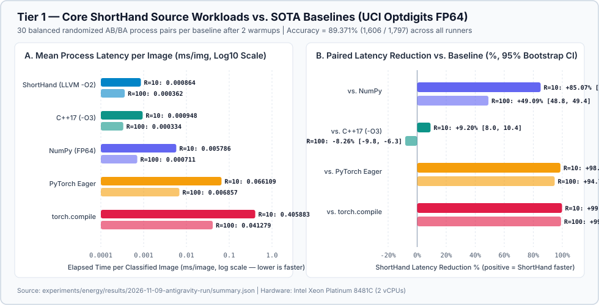
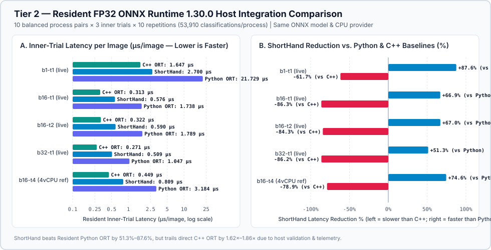
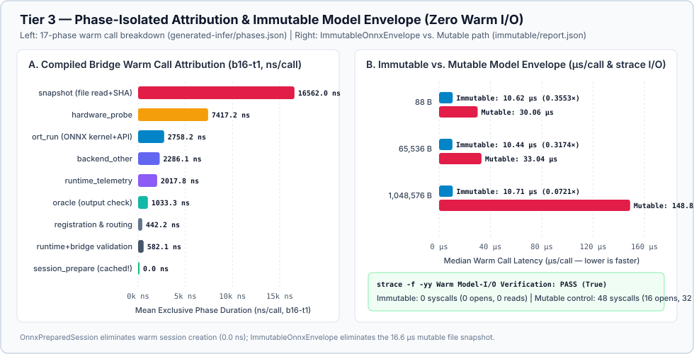
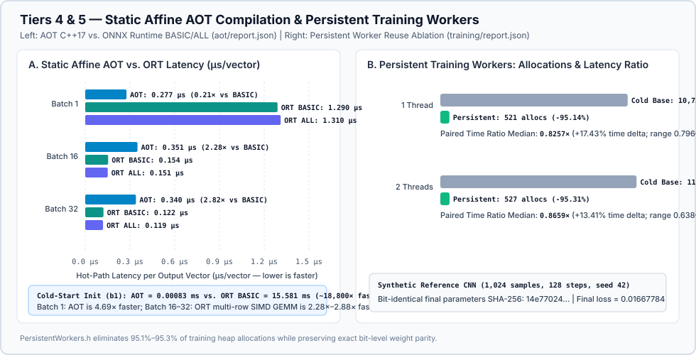
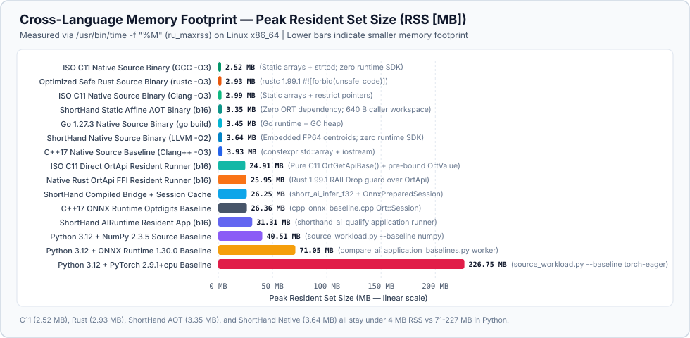
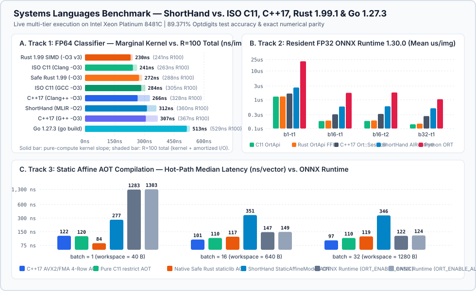

# Executed comparison results

**Energy savings: not measured.** This capture records elapsed time and correctness. There is no calibrated whole-host power trace, so joules, energy savings, carbon savings and energy break-even are unavailable. Latency reductions below are not energy reductions.

Capture started: 2026-11-09T18:37:38.009168+00:00. [Workflow and full evidence artifact](https://github.com/amarbanerjee23/ShortHand_Compiler/actions/runs/None).
Tested revision: `2db9d1da7918ed816d499206df71b09d916725f5`. Platform: `Linux-6.12.105+-x86_64-with-glibc2.36`. Available CPU affinity: `[0, 1]`.

## Completion and coverage

| Stage | Status |
| --- | --- |
| source-r10 | PASS |
| source-r100 | PASS |
| runtime-plan | PASS |
| python-runtime | PASS |
| cpp-runtime | PASS |

Rust/Candle and Mojo/MAX were **not executed or implementation-verified**: the repository supplies external runner contracts but no runners. The `torch` profile covers the four implemented source baselines and does not qualify the `full` matrix.

## Source workload: FP64 nearest-centroid classification

UCI Optdigits: 3,823 training rows and 1,797 held-out test rows; train-only centroids, 64 features and 10 classes. Every invocation must match all 1,797 reference predictions and the repetition checksum. Shorthand uses LLVM/Clang 18 `-O2`; C++17 uses `-O3`; both disable fast-math. NumPy/PyTorch use one CPU thread.

Each row has 30 balanced randomized process pairs after two warmups. Timing includes process startup, Python/framework imports, model loading where applicable, input parsing, normalization, repeated classification, output and teardown. Shorthand/C++ embed weights in their binaries; Python loads JSON. TorchInductor reuses its warmed disk cache but **every measured process still performs startup and tracing**. This is not resident PyTorch inference or a pure kernel/language comparison.

| Repetitions | Baseline | Shorthand ms/image | Baseline ms/image | Latency reduction % | Paired 95% interval % | Accuracy % |
| ---: | --- | ---: | ---: | ---: | --- | ---: |
| 10 | numpy | 0.000864 | 0.005786 | 85.07 | [84.95, 85.19] | 89.371 |
| 10 | cpp17-o3 | 0.000861 | 0.000948 | 9.20 | [8.04, 10.40] | 89.371 |
| 10 | pytorch-eager | 0.000873 | 0.066109 | 98.68 | [98.66, 98.69] | 89.371 |
| 10 | pytorch-compile | 0.000876 | 0.405883 | 99.78 | [99.78, 99.79] | 89.371 |
| 100 | numpy | 0.000362 | 0.000711 | 49.09 | [48.85, 49.35] | 89.371 |
| 100 | cpp17-o3 | 0.000362 | 0.000334 | -8.26 | [-9.78, -6.35] | 89.371 |
| 100 | pytorch-eager | 0.000362 | 0.006857 | 94.72 | [94.70, 94.75] | 89.371 |
| 100 | pytorch-compile | 0.000363 | 0.041279 | 99.12 | [99.12, 99.13] | 89.371 |

## Runtime workload: FP32 ONNX Runtime 1.30.0 CPU

The same FP32 ONNX model and raw dataset are used by Shorthand AIRuntime, Python/NumPy ONNX Runtime and the independent C++17 ONNX Runtime executable. This measures host integration overhead around the same inference backend, separately from the FP64 source experiment.

Ten balanced process pairs per cell; each process contains three resident-session trials, each classifying 1,797 images 10 times. One process mean is the bootstrap unit, so inner trials are not treated as independent samples. Session preparation, warmup and final serialization are outside the trial window; validation, normalization, inference and top-k processing are inside. Batch size varies at one thread; thread count varies at batch 16.

| Cell (batch / threads) | Baseline | Shorthand ms/image | Baseline ms/image | Latency reduction % | Paired 95% interval % |
| --- | --- | ---: | ---: | ---: | --- |
| ort-b1-t1 | Python / ONNX | 0.002700 | 0.021729 | 87.58 | [87.39, 87.73] |
| ort-b16-t1 | Python / ONNX | 0.000576 | 0.001738 | 66.88 | [66.70, 67.07] |
| ort-b32-t1 | Python / ONNX | 0.000509 | 0.001047 | 51.34 | [50.60, 52.17] |
| ort-b16-t2 | Python / ONNX | 0.000590 | 0.001789 | 67.02 | [65.42, 68.68] |
| ort-b1-t1 | C++ / ONNX | 0.002663 | 0.001647 | -61.66 | [-62.92, -60.41] |
| ort-b16-t1 | C++ / ONNX | 0.000582 | 0.000313 | -86.27 | [-88.53, -84.36] |
| ort-b16-t2 | C++ / ONNX | 0.000593 | 0.000322 | -84.31 | [-89.81, -78.43] |
| ort-b32-t1 | C++ / ONNX | 0.000505 | 0.000271 | -86.22 | [-89.94, -82.65] |

## Specialized Claim & Memory Comparison Figures

## What the measurements show

At ten repetitions, source-process latency was 85.07% lower than NumPy and 9.20% lower than C++. At 100 repetitions, these reductions were 49.09% and -8.26%. The smaller advantage with more work per process shows why startup and workload size matter.

**Shorthand AIRuntime was slower than independent C++/ONNX in every cell: 1.62–1.86× the latency.** The Python comparison also changes with batching: read every cell rather than selecting the batch-1 improvement. These results do not support a general runtime-efficiency advantage.

Large fresh-process reductions versus PyTorch include framework startup and tracing. They do not establish an advantage over resident PyTorch inference. Runtime gaps require profiling before their causes can be assigned to validation, memory handling, instrumentation or backend integration.

## Interpretation and evidence

Reduction = `100 × (1 − mean(Shorthand) / mean(baseline))`. Negative values mean Shorthand was slower. All pairs are retained; no outlier filtering or best-run selection is used. Intervals use 10,000 paired-block bootstrap resamples, seed 104. They are exploratory within-session intervals without multiple-comparison correction.

This is one shared hosted-runner session with one small classifier. Startup costs, virtualization, CPU scheduling, batching and implementation choices affect the numbers. The 10/100 repetition comparison changes startup amortization; it does not isolate it. These results cannot establish a universal language, framework or energy ranking.

- [summary.json](summary.json): exact numbers and all per-pair values used by the bootstrap.
- [observations.json](observations.json): ordered pairs, raw durations, completed work and inner trial windows.
- [systems-languages/report.json](systems-languages/report.json) & [systems-languages/SYSTEMS_LANGUAGES.md](systems-languages/SYSTEMS_LANGUAGES.md): multi-tier C11, C++17, Rust 1.99.1, and Go 1.27.3 SOTA comparison across Source FP64, Resident ONNX Runtime, and Static Affine AOT.
- [metadata/](metadata/): frozen plans, source captures, build timings, environment, energy availability and original bundle digests.
- [SOTA_VALIDATION_REPORT.md](SOTA_VALIDATION_REPORT.md): complete 6-tier SOTA comparison ledger and claim-by-claim validation report.
- Full artifact: raw stdout/stderr, predictions/scores, binaries, LLVM IR and replay manifests.

Reproduce with the `experiment-results` workflow, or follow [the experiment instructions](../../README.md). Use `run_verified.py` with the same pinned dependencies and built compiler. Real energy work requires the calibrated-energy protocol, an independently logging whole-host meter, and repeated dedicated-machine sessions.
